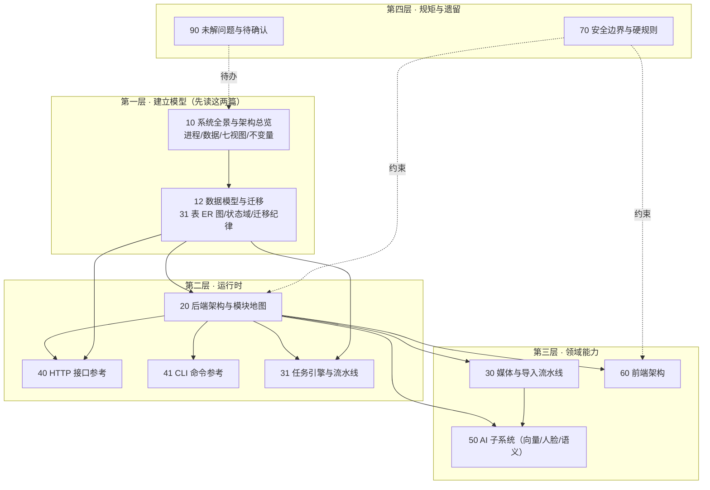

# 00 · 技术参考文档集 · 规范与索引

> **本目录的定位**：`docs/01`–`13` 是"够用就好"的接手笔记（每篇 50–180 行），
> 本目录 `docs/20-reference/` 是**完整正规的技术参考**：架构、功能、数据建模、
> 接口、任务、AI、前端，**该画图的地方画图**，供**人和机器**共同开发与维护。
>
> 本目录是**代码在某一时刻的快照**。代码是唯一真源；本目录与代码冲突时，以代码为准。
> 快照基线见 §5。

---

## 1. 这个目录为谁写

| 读者 | 用它做什么 | 从哪篇开始 |
| --- | --- | --- |
| 第一次接手的人 | 半小时内建立体系模型 | [`10-系统全景与架构总览.md`](10-系统全景与架构总览.md) |
| 要改数据库的人 | 知道表、关系、状态域与迁移纪律 | [`12-数据模型与迁移.md`](12-数据模型与迁移.md) |
| 要加功能的人 | 知道该动哪一层、碰哪些模块 | [`20-后端架构与模块地图.md`](20-后端架构与模块地图.md) |
| 要接界面的人 | 知道外壳、视图、令牌、组件契约 | [`60-前端架构.md`](60-前端架构.md) |
| 要写接口调用的人 | 拿到完整接口表（路径/参数/读写） | [`40-HTTP接口参考.md`](40-HTTP接口参考.md) |
| 要写脚本/自动化的人 | 拿到完整命令表与任务类型表 | [`41-CLI命令参考.md`](41-CLI命令参考.md)、[`31-任务引擎与流水线.md`](31-任务引擎与流水线.md) |
| **机器（AI 编码助手）** | 按 §2 的证据标记定位"哪一句是实测、哪一句还待确认" | 本篇 §2 + [`90-未解问题与待确认.md`](90-未解问题与待确认.md) |

> 【实测】`docs/20-reference/` 由本会话新建（此前 `docs/` 下无该目录），
> 且**不改动** `docs/01`–`13` 任何文件 —— 它们是历史记录。

---

## 2. 三条硬规矩（写给下一个会话，也写给机器）

### 规矩一：代码是唯一真源，文档是快照

`HANDOVER.md` 自己写着"不要凭这份文档的数字下结论"（`HANDOVER.md:4`）。
本目录继承这条：**每一个数字都要能一条命令复算出来**，复算入口见 §4。

### 规矩二：每条结论必须带证据标记

本目录全篇使用两种标记，**不允许出现没有标记的事实性陈述**：

| 标记 | 含义 | 写法要求 |
| --- | --- | --- |
| `【实测】` | 我在写这篇时**真的跑了命令 / 读了那一行代码** | 附 `文件:行号` 或"命令 + 结果" |
| `【推断】` | 由间接证据推出，**没有直接验证** | 必须写出推断依据，便于别人推翻 |

补充约定：

- 引用代码一律写成 `` `相对路径:行号` ``（相对仓库根 `D:\Photoos`），例如
  `photoos/backend/photoos/db/migrator.py:1`。
- 引用**活库**事实时写"只读 SQL + 查询语句"，不写 `file:line`。
- 代码注释/文档里声称的**性能数字**，只能写成"代码声称 X（`文件:行号`）"，
  **不得**改写成"实测 X"。⭐ 本项目在"把前提当事实"上栽过（`HANDOVER.md:1171`）。

### 规矩三：本目录只读、不碰产品数据

写这份文档时**没有**改任何代码、没有写真实库、没有重启服务。
所有数据库访问都是 `mode=ro` 只读连接：

```
sqlite3.connect("file:C:/PhotoOS/data/photoos.db?mode=ro", uri=True)
```

> 【实测】本会话对活库的全部访问都用上面这个只读 DSN；未执行任何
> `INSERT/UPDATE/DELETE/DDL`。

---

## 3. 真源层级（冲突时谁说了算）

```
第 1 层  活库 schema（PRAGMA / sqlite_master）   ← 形态最权威：真实运行的样子
第 2 层  db/migrations/*.sql                     ← 意图最权威：为什么长这样
第 3 层  代码（含测试）                            ← 行为最权威：边界条件都在测试里
第 4 层  docs/01–13、PHASE*_TECH_PLAN.md          ← 历史记录：决策过程，数字会过期
第 5 层  HANDOVER.md / PHASE*_DELIVERY.md          ← 某时刻的实况，最易过期
```

**实践含义**：写"这个系统现在是什么样"用第 1+3 层；写"为什么这么设计"用第 2+4 层。
第 5 层的数字**一律**要重抓（本项目已多次因抄旧数字出错，`HANDOVER.md:1180` 起的一节即是）。

---

## 4. 怎么复算本目录里的数字

### 4.1 只读复算脚本

`docs/20-reference/verify-docs.ps1` **只读**（明令禁止写库、禁止改代码），
一次跑出本目录引用的全部关键数字；每个数字对应本文档 §5 的哪一格都写在脚本注释里。

```powershell
powershell -ExecutionPolicy Bypass -File D:\Photoos\photoos\docs\20-reference\verify-docs.ps1
```

> ⚠️ 必须带 `-ExecutionPolicy Bypass`（本机执行策略会拦脚本，报"禁止运行脚本"，
> 那不是脚本坏了 —— 同类坑见 `HANDOVER.md:1029`）。

### 4.2 手工复算的四个最小命令

```powershell
# ① 活库形态（表/索引/触发器/版本）
$PY="D:\Photoos\.venv\Scripts\python.exe"
$PY -c "import sqlite3;c=sqlite3.connect('file:C:/PhotoOS/data/photoos.db?mode=ro',uri=True);print(list(c.execute(\"SELECT type,name FROM sqlite_master WHERE name NOT LIKE 'sqlite_%'\")));print(c.execute('PRAGMA user_version').fetchone())"

# ② 代码规模（行数按真实换行算）
git -C D:\Photoos ls-files

# ③ 活接口清单（运行中的服务，比源码更可信）
curl.exe -s http://127.0.0.1:8760/openapi.json | findstr /C:"\"paths\""

# ④ 全量测试（约 340 秒）
cd D:\Photoos\photoos; $PY -m pytest tests -q
```

---

## 5. 快照基线（【实测】全部当场复算，2026-10-17）

| 项 | 值 | 证据 |
| --- | --- | --- |
| git HEAD | `33e68e8`（第 4 个提交，分支 `main`，无远端） | `git log --oneline`、`git rev-parse HEAD` |
| 跟踪文件总数 | 339 | `git ls-files \| Measure-Object` |
| 包名 / 版本 | `photoos` / `0.1.0` | `photoos/backend/photoos/pyproject.toml:6-7` |
| Python 要求 / 实跑 | `>=3.12` / **3.12.10** | `pyproject.toml:10`、`$PY -c "import sys;print(sys.version)"` |
| schema 版本 | **9**（迁移文件 9 个，最高 `009_face_verdict.sql`） | `PRAGMA user_version`、`photoos/backend/photoos/db/migrations/` |
| 活库对象 | **31 张表 / 53 个索引 / 1 个触发器 / 0 视图** | 只读 SQL 查 `sqlite_master` |
| 活库大小 | **214.15 MB**（另有 `photoos.db.bak-before-scene-prune` 214.04 MB） | `data/` 目录列举 |
| 后端 Python | 52 文件 / 29,214 行 | `git ls-files` + 逐文件换行计数 |
| 测试 | 57 文件 / 18,652 行；`pytest tests -q` **全绿**（0 失败 / 11 跳过） | 同上 + 当场跑 |
| 前端 JS | 11 模块 / 8,940 行（**ES module，单入口**） | `web/js/`、`web/index.html:543` |
| 前端 CSS | 7 文件 / 5,242 行 | `web/css/` |
| 活库用户数据 | `selection / collection / collection_item` = 13 / 3 / 65 | 只读 SQL 计数 |
| HTTP 接口 | **74 paths / 83 operations**（其中 GET 43 条） | `GET /openapi.json`（运行中的服务） |
| CLI 顶层命令 | **30 个** | `$PY -m photoos --help`（须显式 UTF-8 解码；默认 ANSI 代码页会漏数一个） |
| 活库资产规模（含用户数据） | 照片库 21,340 + 视频库 60 = `asset` 21,400；`shot` 7,371 / `scene` 303 / `session` 78 | 只读 SQL 计数 |
| 向量与人脸 | `embedding` 42,800 / `face` 6,368 / `person` 39 | 只读 SQL 计数 |
| 派生数据 | `thumbnails` 21,401 文件 / 241.0 MB；`previews` 21,401 文件 / **3,601.2 MB** | 目录递归统计 |
| 模型缓存 | `data/ai_cache` 22 文件 / 2,073.4 MB | 同上 |
| 服务 | `127.0.0.1:8760`（`photoos serve`，带 `--log-file`） | `HANDOVER.md` §16.2 |

> 【实测】以上每一格都在本会话跑过；复算入口见 §4。
> 【推断】行数用"真实换行符计数"而非 `Get-Content | Measure-Object -Line`：
> 本仓库**换行符不统一**（见 §7 的 Q-1），后者会少算（例如 `index.html` 报 454 行，
> 真实 546 行）。凡本目录给行数，都是真实换行计数。

---

## 6. 本目录地图（含阅读顺序）



> 【实测】图里的依赖关系来自各篇的实际引用：`40`/`41`/`31`/`30`/`50`/`60` 都要先知道
> 后端分层（`20`），而 `20` 直接来自 `10` 的进程模型与 `12` 的表结构。
> 【推断】`J → C/I` 的"约束"边是本项目特有的：硬规则（原片只读、无评分语言）
> 横切后端与前端，所以画成虚线约束而不是流程边；依据见 `docs/01-arch.md:97-107`。

### 各篇一句话

| 文件 | 内容 | 状态 |
| --- | --- | --- |
| `10-系统全景与架构总览.md` | 系统是什么、进程/部署模型、数据区域、七个视图、全局不变量、技术选型 | ✅ 已交付 |
| `12-数据模型与迁移.md` | 31 张表逐层说明 + 3 张 ER 图 + 状态域 + 分组/精选模型 + 索引 + 迁移纪律 | ✅ 已交付 |
| `verify_docs.py` / `verify-docs.ps1` | **只读**复算脚本：一次跑出本篇 §5 的全部数字 | ✅ 已交付 |
| `20-后端架构与模块地图.md` | 分层、每个子包/模块职责、依赖方向、请求执行模型、错误映射 | ✅ 已交付 |
| `30-媒体与导入流水线.md` | 41 个扩展名、扫描/哈希/元数据/预览/视频 + **铁律 #1 的代码级取证**（打开原片的全部路径） | ✅ 已交付 |
| `31-任务引擎与流水线.md` | 任务 7 态生命周期图、14 种类型步骤表、多进程认领、进度/取消/恢复 | ✅ 已交付 |
| `40-HTTP接口参考.md` | **83 个 operation**（43 GET）逐条表 + 写操作三档 + 路由守卫复核（**脚本生成，不手改**；与线上双向零差异） | ✅ 已交付 |
| `41-CLI命令参考.md` | **30 个命令**与子命令、参数、对应能力（**脚本生成，不手改**） | ✅ 已交付 |
| `50-AI子系统.md` | 两个向量空间、环境隔离、人脸链路、语义重排、性能实况 | ✅ 已交付 |
| `60-前端架构.md` | ES module 图、七视图、组件契约、设计系统令牌、键盘、薄弱点清单 | ✅ 已交付 |
| `70-安全边界与硬规则.md` | 原片只读、路径穿越三层防御、命令白名单、缓存边界 | ✅ 已交付 |
| `90-未解问题与待确认.md` | **45 条**需你确认的问题（分"只改注释"与"需拍板"两类） | ✅ 已交付 |

> 【实测】第 1–2 轮交付 **13 篇文档 + 5 个工具/入口文件**（`verify_docs.py`、`verify-docs.ps1`、
> `tools/make_cli_reference.py`、`tools/make_api_reference.py`、`README.md`）；
> 两个生成器当场跑通：CLI 参考（30 命令）与 HTTP 参考（83 operation，
> **与运行中服务双向零差异**）。**13 篇已全部交付**，无"待写"项。

---

## 7. 需要你确认的问题（**45 条**，详细见 `90-未解问题与待确认.md`）

| 编号 | 一句话 | 建议动作 |
| --- | --- | --- |
| Q-1 | 工作区换行符不统一（`.py` 有 CRLF、`.md` 两种都有），`.gitattributes` 只声明了归一 | 一次 `git add --renormalize` 独立提交 |
| Q-2 | `shot.retired_reason` 实际三个值，`006:107` 注释只写两个 | 改注释（006 已发布不许改） |
| Q-3 | `collection.source_json` 形状：注释写 `feedback`，活数据是 `mode`/`via` | 由你定口径 |
| Q-4 | `require_confirmation_for_destructive` 服务端**从不读它** | 明确文档措辞或补实现 |
| Q-5 | `shot.primary_asset_id` **没有任何外键** | 补约束 / 或写明"靠 I3 断言" |
| Q-6 | `person_face` 两列确信度 **1,695 行全 NULL** | 是否需要显示"模型确信度"（与 §9.2 有张力） |
| Q-7 | 不变式实际 **9 条**，测试文件里写"六条/八条" | ✅ 本轮已修（统一为 9 条） |
| Q-8 | `app_event.kind` 无 CHECK、无常量，实测超出注释白名单 12 个值 | 加 `EVENT_KINDS` 常量 |
| Q-9 | `face` 坐标口径三处矛盾（**已用活库数据裁定：注释错、代码对**） | ✅ 本轮已修（faces.py 注释） |
| Q-10 | "CLIP 用于英文检索"无实现路径（CLIP 无文本塔） | ✅ 本轮已改文案 |
| Q-11 | Scene 三个阈值参数用户**无法配置** | 有意隐藏还是漏接 |
| Q-12 | `concept_ratio` 按分数排序并过滤搜索词下拉框 | **产品判断**：是否算"替你选" |
| Q-13 | 本机 AI 环境缺 GPU onnxruntime/nvidia-*，与文档承诺不符 | 跑一次 `ai doctor` |
| Q-14 | `face_px ≥ 40` 实际在检测坐标系（≈preview 1600px 上 71px） | ✅ 本轮已修（注释补折算） |
| Q-15 | CLIP 下载体积文档写 581 MB，代码实际 335 MB | ✅ 本轮已统一 335 MB |
| Q-16 | `person_profile` 计数只含用户样本，阈值却含 auto 样本 | 界面措辞 |
| Q-17 | `data/` 里有非托管遗留库文件，可能被误当备份 | 归档或改名 |
| Q-18 | `docs/03-data-model.md` 行数基线过期 ≥13 处，迁移纪律描述也与实现不符 | 指向本篇 |
| Q-19 | 视频锚点时间：实现把 UTC 当本地时间，docstring 却说借同目录照片时间 | 修实现或修注释 |
| Q-20 | `config.py` 用 `sys.platform` 却没 `import sys`（macOS 分支会 `NameError`） | ✅ 本轮已修（+回归测试） |
| Q-21 | 「派生图按 sha256 分桶」是错的（实际按 **asset_id** 两级分片） | 已在 `10` 号文档订正 |
| Q-22 | 「重新学习全部」按钮在 `js/` 里**零引用** = 死按钮，说明页却教用户点它 | 接线或删按钮 |
| Q-23 | 说明页三处与实现冲突（抽屉／下载原片／页名） | 改文案 |
| Q-24 | `tokens.css` 自陈 106 个令牌，实测 99 | ✅ 本轮已按实测重写 |
| Q-25 | `photoos.toml` 不是配置来源（只作根标记） | ✅ 本轮已加明示 |
| Q-26 | 排序白名单四份且漂移（`recent` 含义不同，静默改排序） | 收敛成一处 |
| Q-27 | asset 级查询不筛 `retired_at`，shot 级筛 | **需你判定刻意/遗漏** |
| Q-28 | `collection_id` 非数字 → 500 而非 400 | ✅ 本轮已修（400 + 测试） |
| Q-29 | `year` 传整数静默 0 行 | ✅ 本轮已修（+3 条测试） |
| Q-30 | `_collection_clause` 重复定义两份，后者生效（改前一份无效） | ✅ 本轮已删重复定义 |
| Q-31 | 孤儿回收不递增 `retry_count`（与 `docs/04-jobs.md:56` 矛盾） | 定口径 + 补断言 |
| Q-32 | `PENDING` + 遗留 `claimed_by` 死结，任务永远卡住 | 需修 |
| Q-33 | 三个"空转"定义（`video_cover` / 两个 `job_item.state` / `jobs_dir`） | 确认预留还是未完成 |
| Q-34 | 动作目录三处文案/数据不一致（含 `fetch_face` 未标长任务） | ✅ 本轮已订正 docstring |
| Q-35 | 两个 action 端点**没有 HTTP 层测试** | ✅ 本轮已补 6 条 HTTP 测试 |
| Q-36 | `.cr3`/`.raw` 在 `RAW_EXTENSIONS` 里却**没有 raw 解码路由**，无测试覆盖 | 补路由或移出白名单 |
| Q-37 | **IPTC/XMP 完全没有解析代码** | 确认刻意还是缺口 |
| Q-38 | 两条导入路径**去重口径不同**（分类路径不查库内同内容） | 统一口径 |
| Q-39 | `preview.kind='video_cover'` 无写入者（与 Q-33 合并） | 合并处理 |
| Q-40 | `hash_workers` 只用于展示，不影响哈希并发 | ✅ 本轮已加注释 |
| Q-41 | ~~`gps-near` 尾部缺陷~~ → **已核实不是缺陷**（代码早就剥了尾巴） | ✅ 已核实不是缺陷 |
| Q-42 | `PHASE1_DELIVERY.md` 的"19 处"实测为 27 处 | ✅ 订正记在 90 号 |
| Q-43 | 重启后 **< 300 s 的孤儿不会被回收**，运行期也无周期回收 | 加周期回收 |
| Q-44 | `complete()` 与 `cancel()` 窄竞态（取消被 `COMPLETED` 覆盖） | `complete()` 加守卫 |
| Q-45 | `job.type` 数据库层**无 CHECK**（而 `job.status` 有） | 补 CHECK 或指向常量 |

---

## 8. 维护这份文档的三条约定

1. **改代码就顺手改这里对应的那一句**，并保留证据标记；标记从 `【实测】` 退回
   `【推断】` 比留着过期结论安全。
2. **本目录不同步 `docs/09-changelog.md`**：变更流水写那边，这里只写"现在是什么样"。
3. **图用 Mermaid 源码**，` ```mermaid ` 围栏即源码，任何支持 Mermaid 的渲染器
   （GitHub、VS Code、多数 Web 界面）都能直接出图，**不需要构建步骤**。
   【实测】本机无 `mmdc`/`dot`（`mmdc`、`graphviz` 均未安装），故**不产出栅格图**，
   避免引入 Node 依赖 —— 这与项目"零构建前端"的取舍一致（`docs/01-arch.md:114`）。

---

下一篇：[`10-系统全景与架构总览.md`](10-系统全景与架构总览.md) · 返回 [`../README.md`](../README.md)
