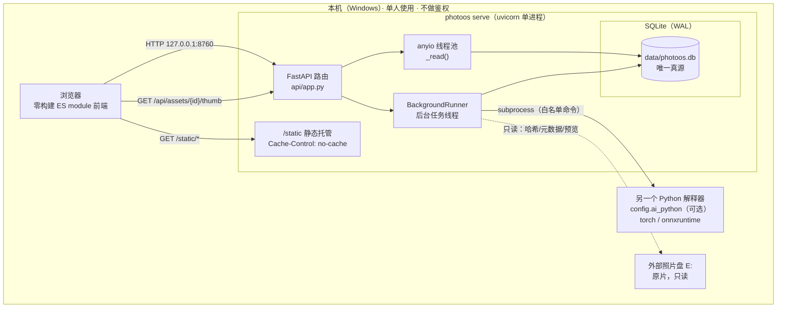
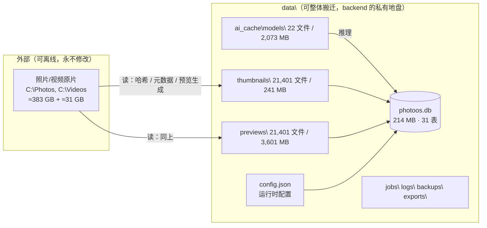
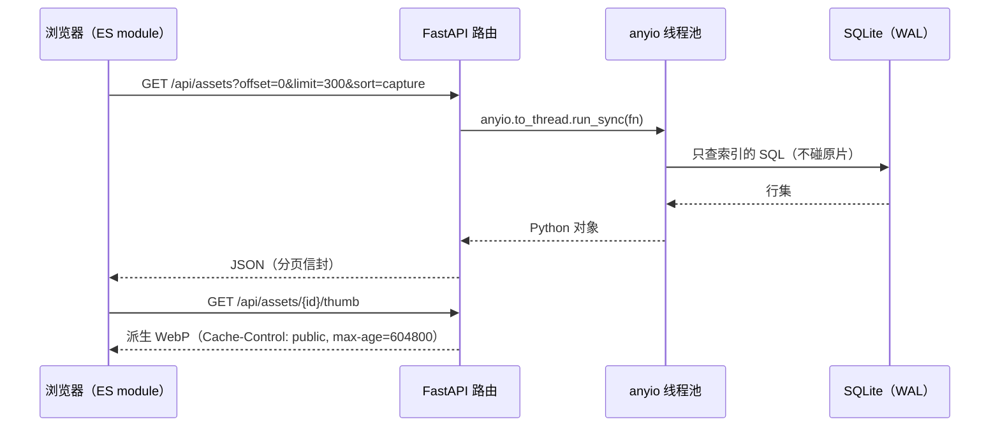

# 10 · 系统全景与架构总览

> 本篇回答三个问题：**这是什么系统**、**它由哪些运行时部件组成**、**一次操作如何穿过这些部件**。
> 需要表级细节看 [`12-数据模型与迁移.md`](12-数据模型与迁移.md)，需要接口清单看
> [`40-HTTP接口参考.md`](40-HTTP接口参考.md)。本篇是全套文档的入口。

---

## 1. 系统是什么

PhotoOS 是**本机、单人使用**的个人摄影管理系统：把一个 2 万张量级的外部照片库
登记成可查询的索引，然后在其上做**精选、找照片、分人、组主题**四件事。

【实测】"单人本地"不是口号，是代码里的取舍：服务默认只监听回环地址、**有意不做鉴权**
（`photoos/backend/photoos/api/app.py:4`），并且**在这一层没有删除原片的入口**
（`app.py:8`）。

【推断】因此本系统的威胁模型与常见 Web 应用不同：**要防的不是"别人访问"，
而是"自己点错"**。这解释了后面三条看起来"多余"的设计 ——
破坏性操作二次确认、动作白名单、路径穿越拦截 —— 它们防的是误操作与代码缺陷，
不是防外部攻击者。依据：`app.py:8`（破坏性操作无入口）+
`docs/01-arch.md:106`（破坏性操作必须二次确认）。

---

## 2. 运行时部件（进程/部署模型）

> 【实测】各部件出处：FastAPI 装配与 lifespan 启停后台执行器 `api/app.py:259-287`；
> 线程池通道 `api/app.py:3395-3404`；静态托管与缓存头 `api/app.py:3346-3379`；
> 单进程 uvicorn 由 CLI 启动（`photoos serve`，见 [`41-CLI命令参考.md`](41-CLI命令参考.md)）。
> 【实测】外部照片盘当前**离线**（`C:\Photos` 不可访问），
> 但浏览/筛选/精选仍可用 —— 这正是"派生数据留在本地"换来的能力。
> 【推断】"AI 解释器可分离"的依据：`pyproject.toml` 把 `onnxruntime`/`torch`
> 放在可选 extra 里（`photoos/backend/photoos/pyproject.toml:48-74`），
> 产品运行环境**故意不装**；细节见 [`50-AI子系统.md`](50-AI子系统.md)。

**这张图里最反直觉的一点**：跑 AI 的解释器**可以不是**跑服务的那个解释器。
服务端在需要算向量/检测人脸时，通过 `subprocess` 调用 `config.ai_python` 指向的环境。
【推断】这不是"设计得漂亮"，是依赖体量与平台轮子可用性逼出来的隔离，
原始决策记录在 `docs/05-ai.md` 与 `pyproject.toml:37-74` 的注释里。

---

## 3. 数据分区：谁是真源，谁能删

| 区 | 位置 | 能不能删 | 证据 |
| --- | --- | --- | --- |
| 原片 | `C:\Photos`、`C:\Videos`（外部盘） | **绝对不能**：铁律 #1 | `docs/01-arch.md:99-100` |
| 索引库 | `data/photoos.db` | 能删，但等于重建索引 | `data/` 列举（214.15 MB） |
| 缩略图/预览 | `data/thumbnails`、`data/previews` | 能删，**重新生成要读原片** | 目录统计：各 21,401 文件 |
| 模型权重 | `data/ai_cache/models` | 能删，重新下载约 2 GB | 目录统计：22 文件 / 2,073.4 MB |
| 备份 | `data/backups`、`photoos.db.bak-*` | 能删 | `data/` 列举 |

> 【实测】表内数字为本会话统计：`asset` 共 21,400 行（照片库 21,340 + 视频库 60，
> 按 `asset.library_id` 分组）、`thumbnails`/`previews` 各 21,401 个文件。
> 复算：`docs/20-reference/verify-docs.ps1`。
>
> ⚠️ **修正一处流传很广的说法**：`docs/01-arch.md:49` 把派生图目录描述为
> "按 sha256 前两位分桶"。**代码与磁盘都不是这样** ——
> `media/adapter.py:6` 写明"路径按 **asset_id** 两级分片，避免单目录堆积十万文件"，
> 磁盘上 `data/thumbnails/` 与 `data/previews/` 的子目录正是 `00`…`NN` 的两位编号。
> 【推断】两者在"两级两位分片"上看起来一样，所以这个说法很难被肉眼发现；
> 区别在于**目录名是内容哈希还是自增 id** —— 影响"同一张照片换了 asset_id 后能否复用缓存"。
>
> ⚠️ 【实测】**`data/` 里同时躺着 3 个非托管库文件**：
> `photoos.db.bak-before-scene-prune`、`config.json.bak-before-ai-python`。
> 它们是历史操作的现场遗留，**不在恢复流程里**（[`70-安全边界与硬规则.md`](70-安全边界与硬规则.md) 会写备份的正规入口）。

---

## 4. 一次请求怎么走

以"照片库翻页"为例（服务端形状见 `api/app.py`）：

> 【实测】线程池通道 `api/app.py:3395-3404`（注释明确写"SQLite 是同步库，
> 直接在 async 路由里调用会阻塞整个服务"）；派生媒体缓存头
> `api/app.py:54-55`；分面与统计用 60 秒短缓存 `app.py:57-62`。
> 【推断】"查询绝不扫描原片"是全局纪律，依据 `docs/01-arch.md:76-79`；
> 本会话抽查 `api/app.py` 中的媒体服务路径只见派生文件读取，未见原片扫描，
> 但**完整证明需要逐路由核对**。

### 4.1 前端资源的缓存策略（踩过坑，别再改回去）

| 资源 | 策略 | 出处 |
| --- | --- | --- |
| `/`（index.html） | `no-cache` + 每次算 ETag | `api/app.py:3372-3379` |
| `/static/*`（js/css/字体） | `no-cache`（子类 `_NoCacheStatic` 补头） | `api/app.py:3364-3370` |
| `/api/assets/{id}/thumb|preview` | `public, max-age=604800` | `api/app.py:55` |
| 分面 / 统计 | `private, max-age=60` | `api/app.py:59,62` |

> 【实测】为什么是 `no-cache` 而不是"禁缓存"：`app.py:3348-3363` 的注释记录了真实故障 ——
> 缺 `Cache-Control` 时浏览器走**启发式缓存**，改完前端会看到"旧 JS + 新 HTML"，
> 表现为"新做的控件出不来"，`Ctrl+F5` 才好。本项目**零构建、文件名无内容哈希**，
> 所以作者选了"允许缓存但必须回服务端校验"。
> 【推断】这意味着："改了前端刷新即可生效"这条经验**依赖上面这段代码存在**；
> 若将来有人移除 `_NoCacheStatic`，会静默回到那个故障。

---

## 5. 七个视图（前端功能面）

【实测】前端是**零构建 ES module**，`index.html` 只挂一个模块入口
（`photoos/backend/photoos/web/index.html:543`），其余模块用
`import ... from './x.js'` 串联（11 个 JS 模块，8,940 行）。

| 视图 | 解决什么 | 主要驱动文件 | 主要接口前缀 |
| --- | --- | --- | --- |
| 照片库 `library` | 按目录/时间/状态/主题翻看全库 | `web/js/app.js` | `/api/assets`、`/api/facets` |
| 精选 `review` | 一个场景一次过完，逐组决定 | `web/js/review.js` | `/api/scenes`、`/api/shots`、`/api/selection` |
| 找照片 `search` | 按画面内容（向量）/ 按时间地点（精确） | `web/js/search.js` | `/api/semantic`、`/api/find`、`/api/filter` |
| 人物 `people` | 人脸聚类 → 命名 → 找更多 | `web/js/people.js` | `/api/people`、`/api/faces` |
| 主题 `collections` | 长期作品集合 | `web/js/collections.js` | `/api/collections` |
| 维护 `maintenance` | 导入、任务、完整性、备份 | `web/js/app.js`、`web/js/actions.js` | `/api/maintenance`、`/api/jobs`、`/api/actions` |
| 说明 `help` | 每个功能怎么用、有什么限制 | `web/js/help.js` | 静态 |

> 【实测】路由分组的接口数量（从 `api/app.py` 的 84 个装饰器统计）：
> people 14、assets 11、collections 8、shots 6、semantic 5、libraries 5、jobs 4、
> faces 3、maintenance 3、sessions 3、exports 3，其余各 1–2。
> 完整逐条表见 [`40-HTTP接口参考.md`](40-HTTP接口参考.md)。
>
> 【推断】"七个视图"是**用户可见页面**的划分；代码里 `app.js` 同时驱动
> 照片库与维护页，所以"页面数"与"JS 模块数"不是一对一（11 个模块 ≠ 7 个视图），
> 这一点在 `docs/01-arch.md:83-95` 的表述里容易被误读。

---

## 6. 六条铁律（**引用项目自己的编号**，别自创）

⭐ 项目有一份**权威的铁律清单**：`photoos/README.md:15-24`，全仓 72 处文档与 26 处代码注释
都用这套编号引用（`铁律 #1`…`铁律 #6`）。**改代码时请用同一套编号**，
不要另起一套（本套文档第一版就自创过 I-1…I-7，已订正 —— 那正是"同一个口径写两处"的坑）。

| # | 铁律（原文要点） | 主要落点 | 违反后的症状 |
| --- | --- | --- | --- |
| **#1** | **原片永不被动**：不移动、不改名、不覆盖、不删除；删除数据库记录 ≠ 删除原文件 | `library/importer.py`（唯一写入）；路由守卫 `tests/unit/test_api.py:600-609`；选择/主题仓储不做任何文件操作 | 用户不可恢复的数据损失 |
| **#2** | **数据库内不出现身份性路径**：不写盘符、不写绝对路径、不写 Windows 用户名；位置身份 = Library UUID + 卷指纹 + `relative_path` | `library/paths.py:46-82` 的 `validate_relative`（拒绝盘符/UNC/`\\?\`/前导分隔符/`..`） | 换盘符/换机器就要全库重建 |
| **#3** | **Asset 是索引的事实单位**；Shot/Session/Scene 只是**可重算的派生线索**，分组出错只重算，绝不丢资产 | `shot_grouping.py`、`scene_grouping.py`；"只增不删"的重算纪律（`repos:2570-2581`） | 重算一次丢一批用户判断 |
| **#4** | **AI/派生数据必须版本化**：缩略图带 `generator_version`，可精确重算而不动原片 | `embedding` 的身份四元组、`preview.generator_version`、模型权重 sha256 | 换模型后结果不可复算、历史被污染 |
| **#5** | **破坏性操作必须二次确认**；Phase 1 不提供任何绕过入口 | `DELETE /api/collections/{id}` 与 `DELETE /api/people/{id}` 都要 `?confirm=true`，否则 **428**（`api/app.py:1697`、`:2443`） | 误删用户整理成果 |
| **#6** | **不扩大范围**：只实现当前 Phase，下一阶段仅预留接口 | PRD §14.11 / §14.14 | 半成品功能混进主流程 |

> 【实测】编号与原文取自 `photoos/README.md:15-24`；代码里的引用点见
> `grep -rn '铁律 #' photoos/backend`（26 处，`#1`…`#5` 都有；`#6` 只在文档里出现）。
>
> 【实测】另外两条**同样硬、但不在铁律清单里**的工程纪律：
>
> | 项 | 出处 | 违反后的症状 |
> | --- | --- | --- |
> | **设计令牌只定义一处**（`web/css/tokens.css` 先加载） | `docs/01-arch.md:103` | "谁生效取决于加载顺序+选择器层级"，本项目最贵的一类 bug |
> | **Windows 控制台必须能显中文**（`cli._force_utf8_io()`） | `docs/01-arch.md:107` | 命令行报错变乱码，排障失效 |

> ⚠️ 【实测】**一处提示**：`require_confirmation_for_destructive` 这个配置项
> 在整个后端只出现两次（定义 + 下发给前端），**没有任何服务端代码读它**。
> 铁律 #5 的实际执行方式是**写死在端点里**（`?confirm=true` → 否则 428），
> 不是靠这个配置项。

---

## 7. 技术选型里"不显然"的几条

| 选择 | 理由 | 出处 |
| --- | --- | --- |
| SQLite（不是 Postgres） | 单机单人、零运维；WAL 让浏览与后台索引并行 | `docs/01-arch.md:113` |
| 零构建前端（无 npm） | 单人使用，装 Node 只为打包 CSS 不划算 | `docs/01-arch.md:114` |
| 深色界面 | **领域性**理由：内容是"看照片然后判断"，浅底干扰对明暗色彩的判断 | `docs/01-arch.md:115` |
| 哈希单线程、元数据多线程 | 外置盘冷读 55–71 MB/s，多线程读同一块盘无收益 | `docs/01-arch.md:116` |
| 服务端与 AI 环境分离 | 产品 venv 不装 torch/onnxruntime | `docs/01-arch.md:117` |

> 【推断】上表是**作者记录的决策理由**，不是本会话的实测结论；
> 其中"外置盘 55–71 MB/s"这类数字属于**硬件实况**，换盘即失效，引用时请重新测。

---

## 8. 规模实况（【实测】2026-10-17）

| 维度 | 值 |
| --- | --- |
| 代码 | 后端 52 文件 / 29,214 行；测试 57 文件 / 18,652 行；前端 11 JS / 8,940 行 + 7 CSS / 5,242 行 |
| 数据 | 31 表 / 53 索引 / 1 触发器 / 0 视图；`photoos.db` 214.15 MB |
| 内容 | 照片 21,340 + 视频 60；`shot` 7,371 / `scene` 303 / `session` 78 |
| 派生 | 缩略图 21,401 文件 / 241 MB；预览 21,401 文件 / 3,601 MB；模型 22 文件 / 2,073 MB |
| 接口 | 74 paths / 83 operations（GET 43） |
| 命令 | CLI 顶层 **30** 个命令 |
| 测试 | `pytest tests -q` 全绿（0 失败，11 跳过，约 340 s） |

复算入口：`powershell -ExecutionPolicy Bypass -File docs\20-reference\verify-docs.ps1`。

---

## 9. 本篇之外还该读什么

* **表结构与状态域** → [`12-数据模型与迁移.md`](12-数据模型与迁移.md)（下一步要写的重点）
* **后端每个模块干什么** → [`20-后端架构与模块地图.md`](20-后端架构与模块地图.md)
* **导入一次照片会发生什么** → [`30-媒体与导入流水线.md`](30-媒体与导入流水线.md)
* **为什么有"任务"这一层** → [`31-任务引擎与流水线.md`](31-任务引擎与流水线.md)
* **不变量逐条取证** → [`70-安全边界与硬规则.md`](70-安全边界与硬规则.md)

---

下一篇：[`12-数据模型与迁移.md`](12-数据模型与迁移.md) · 返回 [`README.md`](README.md)
