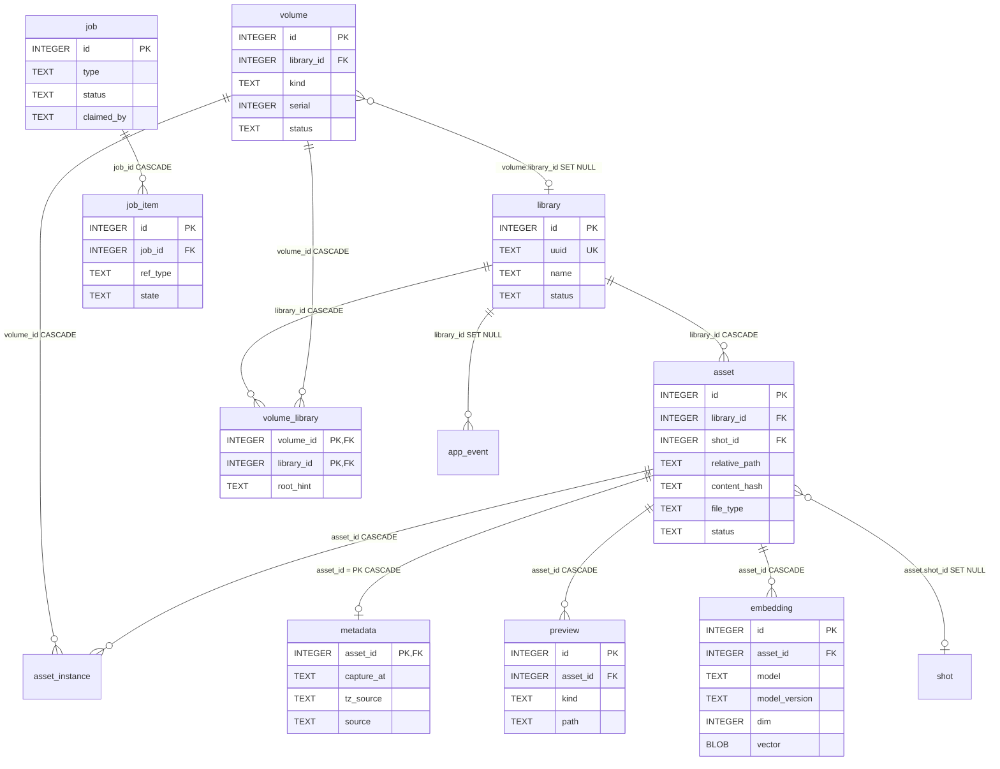
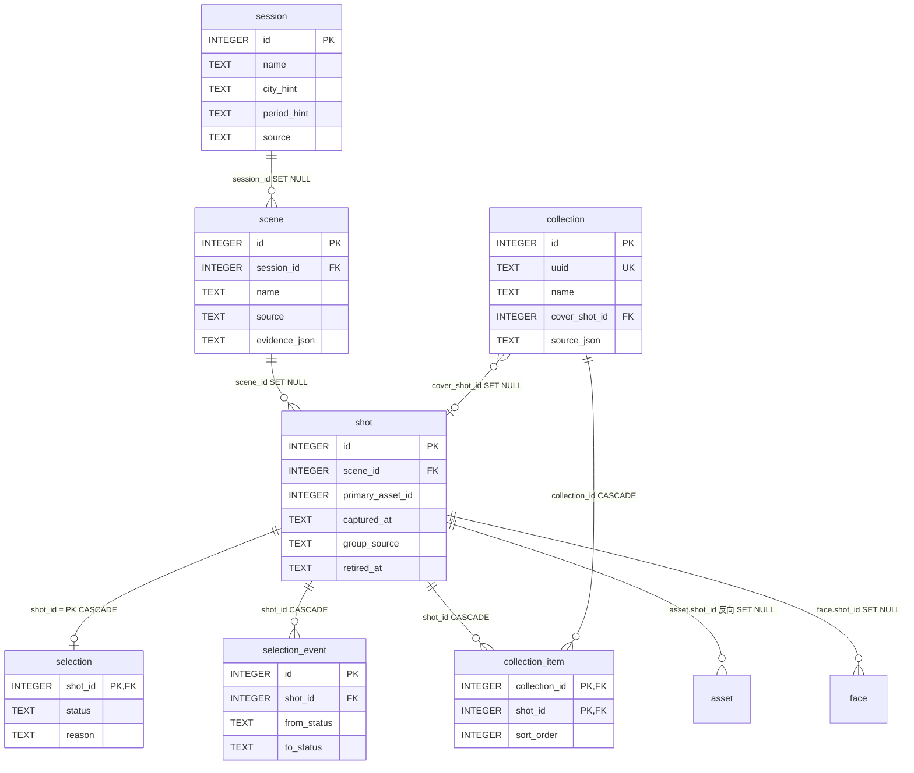
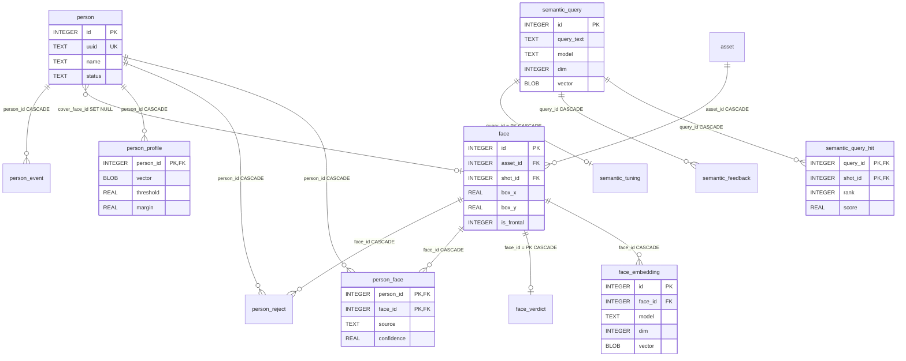

# 12 · 数据模型与迁移

> 本篇是 PhotoOS 的**完整数据模型参考**：三层实体、逐表说明、状态域、
> 关键不变式、索引策略与迁移纪律。所有关系都取自**活库的 `PRAGMA`**（不是迁移文件的意图），
> 所有"代码怎么强制"都指到具体文件与行。
>
> 取证基线：`docs/20-reference/00-文档规范与索引.md` §5；本会话对活库只读（`mode=ro`）。
> ⚠️ 本篇的**行数是某一时刻的快照**，会过期；结构（表/列/外键/约束）才是本篇主张的内容。

---

## 1. 基线事实（【实测】）

| 项 | 值 |
| --- | --- |
| `PRAGMA user_version` | **9** |
| 迁移账本 | `schema_migrations` 9 行；9 个迁移文件的 sha256 与账本 checksum **9/9 一致** |
| 表 / 索引 / 触发器 / 视图 | **31 / 53（另有 18 个自动索引）/ 1 / 0** |
| 日志模式 | `wal`（落盘属性；只读连接也能观察到） |
| `PRAGMA foreign_key_check` | **0 违规** |
| SQLite 版本 | 3.49.1 |
| 库文件 | `data/photoos.db`，214.15 MB |

> 【实测】"没有 analysis 表"是**有意**的：迁移注释明写本期不建标签体系、不建 analysis 表
> （`db/migrations/007_phase3_semantic.sql:12`、`008_phase4_people_review.sql:15`）。
>
> ⭐ **最重要的一条基线**：**迁移文件与活库 schema 没有结构性漂移**。
> 漂移发生在**文档**里 —— `docs/03-data-model.md` 自称 2026-10-15 基线，
> 实测至少 13 处行数对不上（详见 §7）。

---

## 2. 实体三层

数据模型按"离物理世界多远"分三层，这是理解全库的钥匙：

> 【推断】"决策单位是 shot 不是 asset"是**整库最重要的建模决定**：
> 精选、主题成员、语义命中全部落在 `shot` 上（`selection.shot_id`、
> `collection_item.shot_id`、`semantic_query_hit.shot_id` 三个外键都是 → `shot`）。
> 依据：活库 `PRAGMA foreign_key_list` 实测。它的产品含义是
> **"用户做的决定是针对一组连拍，不是针对某一张文件"**。

### 2.1 ER 图 · 核心层（文件与位置）

### 2.2 ER 图 · 业务层（决策单位）

> ⚠️ 【实测】图中 **`shot.primary_asset_id` 故意画成普通列、不画关系**：
> 活库 `PRAGMA foreign_key_list(shot)` **只有一条**（`scene_id` → `scene` SET NULL），
> 该列**没有任何外键**，尽管 `001_core.sql:91` 的注释承诺了"删除时置空"。
> 详见 §8 与 [`90-未解问题与待确认.md`](90-未解问题与待确认.md) 的 Q-5。

### 2.3 ER 图 · 人物与语义层

> 【实测】`face.shot_id` 用 **SET NULL**（不是 CASCADE）是刻意的：
> `008_phase4_people_review.sql:43` 写明"删分组不该删掉'这张脸存在'的事实"。

---

## 3. 逐表参考

行数 = 本会话只读 `COUNT(*)` 快照。**结构列是主要内容，行数仅供参考。**

### 3.1 物理层

| 表 | 行数 | 用途 | 建表 |
| --- | --- | --- | --- |
| `library` | 2 | 一个"库"的稳定身份（uuid + 状态） | `001_core.sql:19` |
| `volume` | 1 | 物理卷（序列号/指纹/文件系统/标签/状态） | `001_core.sql:32` |
| `volume_library` | 2 | 卷 ↔ 库多对多 + 各自根路径提示 | `002_volume_library.sql:11` |
| `asset` | 21,400 | **物理事实单位**：一个被扫描到的文件一行 | `001_core.sql:106` |
| `asset_instance` | **0** | 同一内容的多份物理副本 | `001_core.sql:133`（+`002:30` 加 `library_id`） |
| `metadata` | 21,400 | `asset` 的 1:1 宽表（35 列：相机/曝光/时间/GPS/视频） | `001_core.sql:151` |
| `preview` | 42,800 | 派生图，每 asset 两行（`thumb` + `preview`） | `001_core.sql:196` |
| `embedding` | 42,800 | 图像向量，每 asset 两个模型身份并存 | `006_phase2_selection.sql:68` |
| `job` / `job_item` | 65 / 37,362 | 后台任务与任务内逐条记录 | `001_core.sql:211,233` |
| `app_event` | 80 | 全局事件流 | `001_core.sql:251` |

**值得注意的实测事实**：

* 【实测】`asset_instance` **0 行** —— 表存在但当前库没用上（唯一读它的是 `api/queries.py:273`）。
* 【实测】`asset` 21,400 行全部挂上了 `shot_id`（无 NULL），`content_hash` 无 NULL，
  `hash_algo` 全 `blake3`，`status` 全 `OK`。
* 【实测】`asset.file_type` = `jpeg` 13,239 / `raw` 8,101 / `video` 60；
  对应 `mime` = `image/jpeg` / `image/x-nikon-nef` / `video/quicktime`。
  按库分：照片库 21,340（382.60 GB）、视频库 60（30.68 GB）。
* 【实测】`metadata.source` = `pillow` 13,239 / `libraw` 8,101 / `ffmpeg` 60；
  `source_enrichment` = `pillow` 8,101 / NULL 13,299（RAW 走 LibRaw 主体 + Pillow 补充）。
* 【实测】`asset.library_id` 是**唯一**的 NOT NULL 外键列；其余 FK 列可空。

### 3.2 业务层

| 表 | 行数 | 用途 | 建表 |
| --- | --- | --- | --- |
| `session` | 78 | 时段（半天/一次出行）。**全局表，无 library_id、无外键** | `001_core.sql:54` |
| `scene` | 303 | 场景（一次拍摄），属一个 session | `001_core.sql:68` |
| `shot` | 7,371 | 拍摄组 —— **精选/主题/检索的决策单位** | `001_core.sql:86` |
| `selection` | 13 | 每个 shot **当前**的精选档位 | `001_core.sql:268` |
| `selection_event` | 24 | 精选状态变更流水（from → to） | `001_core.sql:276` |
| `collection` | 3 | 用户主题（跨时间地点的作品集） | `006:28`（+`008:251` 加 `source_json`） |
| `collection_item` | 65 | 主题成员（成员是 **shot** 不是 asset） | `006:44` |

* 【实测】`session` 是**全局**的：照片与视频共享同一套时段（`005_session_identity.sql:4-7`）。
* 【实测】`shot` 当前 7,371 行**全部活跃**（`retired_at IS NULL`），
  `group_source` 全 `auto`（**没有任何被冻结的组**），`group_revision` 全 = 8。
* 【实测】`selection` 13 行 = `FINAL` 11 / `SELECTED` 2，`reason` 全 NULL。
* 【实测】`collection_item` 分布：id=1「日出」1 条、id=3「月亮」63 条、id=4「鸟」1 条。

### 3.3 人物与语义层

| 表 | 行数 | 用途 | 建表 |
| --- | --- | --- | --- |
| `face` | 6,368 | **检测事实**：某 asset 上的第 N 张脸（框 + landmarks） | `008:39` |
| `face_embedding` | 6,368 | 人脸特征向量（SFace 128 维） | `008:73` |
| `face_verdict` | 68 | 人工判定"这不是人" | `009:30` |
| `person` | 39 | 人物（`name` 可空 = 模型提议未命名） | `008:95` |
| `person_face` | 1,695 | 归属**正例** | `008:114` |
| `person_reject` | 341 | 归属**反例**（一等事实，不是"缺一行"） | `008:134` |
| `person_profile` | 39 | 学到的原型（均值向量 + 阈值 + margin），**不是微调后的网络** | `008:157` |
| `person_event` | 793 | 人物操作流水（14 种 action） | `008:178` 建，`009:59-77` **重建** |
| `semantic_query` | 44 | "被问过的词" + 文本向量 | `007:29` |
| `semantic_query_hit` | 2,625 | 命中快照（落 shot；`rank` 是 0-based **排序位，不是评分**） | `007:62` |
| `semantic_feedback` | 67 | 用户对某词结果的表态（`keep` 63 / `drop` 4） | `008:202` |
| `semantic_tuning` | 2 | 由表态学出的正/负向量与重排系数 | `008:227` |

* 【实测】`face` 的框坐标是**原 preview 像素坐标**，可为负（实测 `box_x ∈ [-9.095, 1562.627]`），
  与 `008:35-37` 的说明一致。
* 【实测】`person_face` = `user` 1,082 / `auto` 613；两列 `confidence`/`similarity`
  **1,695 行全 NULL** → 见 [`90-未解问题与待确认.md`](90-未解问题与待确认.md) Q-6。
* 【实测】`person` 39 行 = `named` 11 / `proposed` 19 / `archived` 9，`name IS NULL` 28 行。
* 【实测】"不是人"的读取端语义：所有列人的查询都带
  `NOT EXISTS (SELECT 1 FROM face_verdict ...)`（`repos/__init__.py:2115,2373,2395,2487,2515`）——
  **判定不删脸，只是把脸从人的视野里摘出去**（`009:24-27`）。

---

## 4. 两个子系统（读这段能省一整天）

### 4.1 精选：`selection` 是"当前状态"，`selection_event` 是"历史"

| 表 | 语义 | 关键点 |
| --- | --- | --- |
| `selection` | 每个 shot **当前**档位，**没有行 = 从未审阅** | PK = FK = `shot_id`（`001:269`） |
| `selection_event` | 追加式流水 | `shot_id` **永不搬迁**（历史不可改写，`repos:2699`） |

* 【实测】唯一写路径 `repos/__init__.py:1096-1115`：
  `INSERT ... ON CONFLICT(shot_id) DO UPDATE`，其中
  `reason = COALESCE(excluded.reason, selection.reason)` —— **不传理由时保留旧理由**，
  然后立刻插一条 `selection_event`。
* 【实测】**四态不是流程**：`library/selection.py:11-13` 明写"不设转移白名单，
  任意状态可跳到任意状态"。
* 【实测】状态没变且没给理由 → **不写库**（`selection.py:104-110`）。
* 【实测】**退役守卫**：给不存在或已退役的 shot 标精选 → `ValueError`
  （`repos:1081-1088`；测试 `tests/unit/test_phase2_db_invariants.py:430-441`）。
* 【实测】活库 `selection_event` 24 行，`reason` 唯一非空的来源是重算搬迁，
  写入固定值 `reason='migrated_from:<old_shot_id>'`（`repos:2719-2723`）。

### 4.2 主题：为什么封面是"三级回退"

* 【实测】成员是 `shot`，`add_shots` 用 `INSERT OR IGNORE` +
  主键 `(collection_id, shot_id)` → **重复加入天然幂等**（`repos:908`、`006:41-43`）。
* 【实测】封面 = `COALESCE(cover_shot_id, 主题内 sort_order 最小的活跃 shot)`，
  结果字段名 `effective_cover_shot_id`（`repos:691-695`）。
* 【实测】`collection.source_json` 记录主题**来源**（如"由某个搜索词建的主题"），
  解析失败**不抛异常**（`repos:35-48`）—— 理由：来源只是解释性信息。
  ⚠️ 但它的形状与迁移注释不一致，见 [`90-未解问题与待确认.md`](90-未解问题与待确认.md) Q-3。

---

## 5. 分组模型：`session → scene → shot → asset`

* 【实测】正向链：`session` → `scene` → `shot` → `asset`（`asset.shot_id`）；
  反向也是唯一链路（`repos:2587`）。
* 【实测】`shot.captured_at` = 组内**最早**照片的本地时间；视频容器 UTC 不参与（`repos:2585-2586`）；
  `capture_date_local` = `captured_at[:10]`（`repos:2977`）。

### 5.1 `retired_at`：为什么"只增不删"

* 【实测】`selection.shot_id` 是 **CASCADE**，物理删 shot 会**连带删掉精选**；
  所以重算一律标 `retired_at` 而**不 DELETE**（`repos:2570-2581`、`006:100-106`）。
* 【实测】继承者规则（`repos:3011-3033`）：看"退役前属于该 shot 的资产现在归到哪个 shot"，
  取**重合最多**者，并列取 id 最小者。
* 【实测】**必须记在退役行上**的原因（`repos:3035-3044`）：下一个事务的
  `UPDATE asset SET shot_id` 会永久覆盖"这些资产原来属于谁"，事后无法推断。
* 【实测】读取端兜底 `reconcile_stranded_references()`（`repos:2763-2856`）：
  先按 `retired_reason` 记的 `<id>` 取继承者，取不到才退回"资产多数归属"推断。
* ⚠️ 【实测】**活库 `retired_at IS NOT NULL` 的行数 = 0**，
  所以上面三条规则在真实数据上**还没有样本**。这是"代码完备但未经实战"的部分。

### 5.2 冻结：没有 `frozen` 列

* 【实测】**冻结 = `shot.group_source = 'user'` 且 `retired_at IS NULL`**
  （`repos:2612-2644`）。活库当前 `group_source='user'` 行数 **0**。
* 【实测】三道守卫（`repos:2891-2960`）：冻结 shot 不得被退役；
  冻结 shot 不得出现在重算方案里；**冻结 shot 名下的资产**不得出现在方案里。
* 【实测】第三道守卫存在的理由（`repos:2927-2937`）：方案里出现的是**新** shot
  （`shot_id=None`），第二道看不到，而 `UPDATE asset SET shot_id` 会把资产搬空，
  让锁定组变成空壳**且断言全绿**。
* 【实测】`effective_frozen = 传入的 frozen ∪ protected_ids()`（`repos:2891,2941`），
  注释明写"漏传 `frozen=` 会让两道守卫全部失效"。

> ⭐ **这是本库最值得学的一条建模经验**：**"行数不变"不等于"用户还看得见"**。
> 作者在 `live_selection_counts()`（`repos:3354-3374`）里记录了实测：
> 真实库标 60 个 FINAL 后把 `--gap-seconds` 从 3 改成 2，**9 条精选落到退役 shot 上**，
> 界面上 FINAL 从 60 变 51 —— 而如果只数行数，一切"正常"。

---

## 6. 状态域：每个枚举值由谁强制

分三类。**读这张表能避免"以为数据库会拦"的误判。**

### 6.1 有 SQL `CHECK` 的列（数据库强制）

| 列 | 允许值 | 位置 |
| --- | --- | --- |
| `library.status` | `ONLINE` / `OFFLINE` / `MISSING` / `UNBOUND` / `SCANNING` | `001:25-26` |
| `volume.kind` | `fixed` / `removable` / `network` / `cdrom` / `ram` / `unknown` | `001:35-36` |
| `volume.status` | `ONLINE` / `OFFLINE` / `UNKNOWN` | `001:42-43` |
| `session.source` / `scene.source` / `shot.group_source` | `auto` / `user` | `001:59,75,93` |
| `asset.file_type` | `raw` / `jpeg` / `heic` / `png` / `tiff` / `webp` / `video` / `other` | `001:116-117` |
| `asset.status` | `PENDING` / `OK` / `MISSING` / `UNREADABLE` / `QUARANTINED` / `SKIPPED` | `001:118-119` |
| `metadata.tz_source` | `exif-offset` / `container-utc+assumed` / `unknown` / `file-mtime` | `001:174` |
| `metadata.source` | `libraw` / `pillow` / `exifread` / `exiftool` / `ffmpeg` / `none` | `001:181-182` |
| `preview.kind` | `thumb` / `preview` / `video_cover` | `001:199` |
| `job.status` | `PENDING` / `PROCESSING` / `COMPLETED` / `FAILED` / `RETRY` / `CANCELLED` / `PAUSED` | `001:214-215` |
| `job_item.state` | `PENDING` / `PROCESSING` / `DONE` / `FAILED` / `SKIPPED` | `001:239-240` |
| `selection.status` | `UNREVIEWED` / `CANDIDATE` / `SELECTED` / `FINAL` | `001:270-271` |
| `person.status` | `proposed` / `named` / `archived` | `008:104` |
| `person_face.source` | `auto` / `user` | `008:123` |
| `face_verdict.verdict` | **只有 `not_person`**（注释明写不许加第二个值） | `009:32-36` |
| `person_event.action` | 14 个：`discover`/`assign`/`confirm`/`reject`/`rename`/`learn`/`merge`/`profile`/`dissolve`/`restore`/`move_in`/`move_out`/`not_person`/`person_again` | `009:66-69` |
| `semantic_feedback.action` | `keep` / `drop` | `008:210` |

【实测】活库观察值**全部落在上述集合内**（无脏数据）：
`selection.status` ∈ {FINAL 11, SELECTED 2}；`job.status` ∈ {COMPLETED 58, CANCELLED 4, FAILED 3}；
`person.status` ∈ {archived 9, named 11, proposed 19}；`face_verdict.verdict` 68/68 = `not_person`；
`job_item.state` = {DONE 37,041, FAILED 321}。

### 6.2 由触发器强制

* 【实测】`selection_event.from_status` / `to_status` 必须是四态之一，否则
  `RAISE(ABORT, ...)`：触发器 `trg_selection_event_status_insert`
  （`006:134-142`，活库唯一触发器）。
* 【实测】为什么用触发器而不是 CHECK：`006:131-133` 写明
  "SQLite 不支持 `ALTER TABLE ADD CONSTRAINT`，重建表会动到既有数据，触发器是纯增量"。

### 6.3 **无 CHECK**、只靠 Python 常量（容易误判的一类）

| 列 | 真实域 | 强制位置 | 风险 |
| --- | --- | --- | --- |
| `job.type` | 14 个（`JOB_TYPES`） | `jobs/queue.py:24-49`；入队校验 `queue.py:130-131` | 入队会被拦，**直接 SQL 写入不会被拦** |
| `job_item.ref_type` | 注释给 `asset`/`path`/`library` | **无强制** | 实测只有 `asset` |
| `app_event.kind` | 注释只列 6 个，**实测 14 个** | **无强制、**无常量（唯一入口 `library/store.py:392-401` 直接 INSERT） | 写入端可写任意字符串 |
| `semantic_query.text_kind` | 注释 `query`/`document` | **无强制** | 实测 44/44 = `query` |
| `shot.retired_reason` | 三种（见 §5.1） | **无强制** | 与 `006:107` 注释不一致 → Q-2 |
| `asset.hash_algo` | `blake3`/`sha256` | **无强制** | 实测全 `blake3` |
| `collection.source_json` | 形状只在注释里 | **无强制** | 与活数据不一致 → Q-3 |

### 6.4 派生数据的身份：用 `UNIQUE` 而不是枚举

* 【实测】`embedding` 身份 = `(asset_id, model, model_version, prep_version)`（`006:81`）。
  活库两个身份并存：`clip-vit-base-patch32` / `xenova-onnx-fp32` / `p1.0` / `dim=512`，
  以及 `embeddinggemma-2` / `safetensors-fp32` / `eg2-p1.0` / `dim=768`；各 21,400 行。
* 【实测】`face` 去重键 = `(asset_id, detector, detector_version, box_x, box_y)`（`008:62`）；
  实测全 `yunet-2023mar` / `cv2-5.0.0`。
* 【实测】`person_profile` 主键 = `(person_id, model, model_version, prep_version)`（`008:171`）。

> 【推断】用"身份四元组 + UNIQUE"而不是枚举列，好处是**换模型不用改 schema**：
> 新模型只是多一个身份，旧向量继续可用。这与"CLIP 与 EG2 并存"的产品决策一致。

---

## 7. 索引策略

【实测】显式索引 53 个（另有 18 个自动索引）。要点：

| 类型 | 例子 | 为什么这么建 |
| --- | --- | --- |
| **部分索引**（只索引活跃行） | `idx_shot_active` = `shot(scene_id) WHERE retired_at IS NULL`（`006:111-112`） | 界面只关心活跃行，索引体积与"只增不删"并存 |
| **部分唯一索引** | `uq_session_city_period` = `UNIQUE(session.city_hint, period_hint) WHERE 两者皆非空`（`005:9-17`） | 只约束"由分类写入的行"，不动既有只有名字的 Session |
| 认领顺序 | `idx_job_status` = `job(status, priority, id)`（`001:230`） | 与 `queue.py:207-216` 的 `ORDER BY` 严格一致 |
| 只认领无归属或自己的 | `idx_job_claimed` = `job(status, claimed_by)`（`004:8-13`） | 支持多进程/重启后的归属安全 |
| 反查"属于哪些主题" | `idx_collection_item_shot`（`006:53-54`） | 主题反查 |
| 时间倒序列出 | `idx_face_verdict_created` = `face_verdict(created_at DESC)`（`009:42-44`） | 主键已是 face_id，但仍要按时间列 |
| 增量补算的驱动查询 | `idx_embedding_created`（`006:86-87`） | 找出"还没有该版本向量"的 asset |

> 【实测】`scene` 只有 1 个显式索引，`session` 只有那个部分唯一索引，
> `semantic_tuning` 与 `schema_migrations` **没有任何显式索引**（主键即唯一）。

---

## 8. 迁移纪律（改 schema 前必读）

### 8.1 机制

| 环节 | 实现 | 位置 |
| --- | --- | --- |
| 命名 | `NNN_name.sql`，正则校验，不合规即报错 | `db/migrator.py:23,48-53` |
| **编号即目标版本** | `PRAGMA user_version` = 目录里最大编号 | `migrator.py:4,80-82` |
| 重号/空目录/缺 001 | 全部报错 | `migrator.py:55-58,71-76` |
| 单事务 | `BEGIN;`/`COMMIT;` 写进脚本文本再 `executescript()` | `migrator.py:277-285` |
| schema 变更与记账同事务 | `_run_migration_sql` + `INSERT schema_migrations` + `PRAGMA user_version` | `migrator.py:337-350` |
| 迁移前自动备份 | `VACUUM INTO data/backups/pre_schema<N>_<时间戳>.db`，**备份失败即中止** | `migrator.py:323-330` |
| 迁移后复核 | `db.schema_version()` 必须等于期望值，否则报错 | `migrator.py:358-362` |
| 账本自建 | `schema_migrations` **不属于任何迁移** | `migrator.py:110-123` |
| 写事务 | `BEGIN IMMEDIATE` | `connection.py:111-123` |

### 8.2 三条必须遵守的规则

1. **只追加，不修改。** 已应用迁移被事后修改 → checksum 不匹配 →
   **拒绝启动**（`migrator.py:7,126-164`）。⚠️ 本项目有"因为不许改 008，
   所以 009 用'建新表→拷数据→改名'重建 `person_event`"的真实先例（`009:51-77`）。
2. **迁移文件内不得出现独立事务控制语句**（`BEGIN`/`COMMIT`/`ROLLBACK`/`SAVEPOINT`/`RELEASE`）；
   校验先掩掉注释与字符串字面量，且放行 `CREATE TRIGGER ... BEGIN ... END`（`migrator.py:184-255`）。
3. **SQLite 的两种"改不了"有既定处置**：加约束 → 用**触发器**（`006:131-133`）；
   删约束 → **重建表三步**（`009:51-53`）。

### 8.3 版本落后 / 领先的行为

| 情形 | 行为 | 位置 |
| --- | --- | --- |
| 落后 | `apply_migrations` 会补齐（只应用 `version > from_version` 的）；但**不会自动发生** —— API 启动路径**不调用**它，只有 `photoos init` 会调 | `migrator.py:316`、`cli.py:3296` |
| 落后（运行期表现） | `/api/health` **并排报** `schema_version` 与 `schema_expected`；缺表时给可照做的提示而不是 500 | `api/app.py:469-470`、`api/app.py:1226-1230` |
| 领先 | 抛 `SchemaVersionMismatch`："数据库 schema 版本高于当前程序支持……请升级程序" | `migrator.py:172-181,308-311` |
| 降级 | **不支持**：靠备份恢复（停服务 → 用 `data/backups/` 快照替换 `photoos.db`，**同时删 `.db-wal`/`.db-shm`** → `photoos init`） | 项目 README |

### 8.4 连接期 PRAGMA

【实测】所有连接：`foreign_keys = ON`、`busy_timeout`、`temp_store = MEMORY`；
**非只读**连接额外：`journal_mode = WAL`、`synchronous = NORMAL`、
`wal_autocheckpoint = 1000`、`cache_size = -65536`（64 MiB）、`mmap_size = 268435456`（256 MiB）
（`db/connection.py:74-87`）。只读连接走 `file:...?mode=ro` URI（`connection.py:61-63`）。

---

## 9. 文档与代码的漂移（本篇的另一个作用）

【实测】`docs/03-data-model.md` 自称 2026-10-15 基线并要求"拿它当基线"，
但至少 13 处行数已过期：

| 表 | 03 号文档 | 本篇实测 |
| --- | --- | --- |
| `selection` | 8 | **13** |
| `selection_event` | 8 | **24** |
| `face_verdict` | 34 | **68** |
| `person` | 40 | **39** |
| `person_face` | 1,487 | **1,695** |
| `person_reject` | 80 | **341** |
| `person_event` | 424 | **793** |
| `app_event` | 64 | **80** |
| `job` | 58 | **65** |
| `semantic_query` | 38 | **44** |
| `semantic_query_hit` | 1,797 | **2,625** |
| `collection_item` | 64 | **65** |
| `person_profile` | 40 | **39** |

另：【实测】`docs/03-data-model.md` 要求"每次迁移都应可重复运行（`CREATE TABLE IF NOT EXISTS`）"，
但 **001–009 里一个 `IF NOT EXISTS` 都没有**；真正提供幂等的是
`migrator.py:316` 的版本过滤与账本。

> 【推断】这正是本项目"不要相信文档里的数字"这条纪律的活证据。
> 本篇的做法是：**结构主张给 `file:line`，行数主张给复算脚本**
> （`docs/20-reference/verify-docs.ps1`），并明确标注"行数会过期"。

---

## 10. 本篇引出的疑问

以下 6 条需要你确认（完整版见 [`90-未解问题与待确认.md`](90-未解问题与待确认.md)）：

| 编号 | 一句话 |
| --- | --- |
| Q-2 | `shot.retired_reason` 实际有三个值，但 `006:107` 注释只写两个（且 006 不许改） |
| Q-3 | `collection.source_json` 的形状：注释写 `feedback`，活数据是 `mode`/`via` |
| Q-5 | `shot.primary_asset_id` 没有任何外键，只有 `001:91` 注释承诺过 |
| Q-6 | `person_face.confidence`/`similarity` 1,695 行全 NULL（模型确信度从未落库） |
| Q-7 | ~~不变式到底几条？测试文件里"六条/八条"互相矛盾~~ → **本轮已统一为 9 条**（I1–I9） |
| Q-8 | `app_event.kind` 无 CHECK、无常量，实测已超出注释白名单 12 个值 |

---

返回 [`00-文档规范与索引.md`](00-文档规范与索引.md) · 上一篇：[`10-系统全景与架构总览.md`](10-系统全景与架构总览.md)
