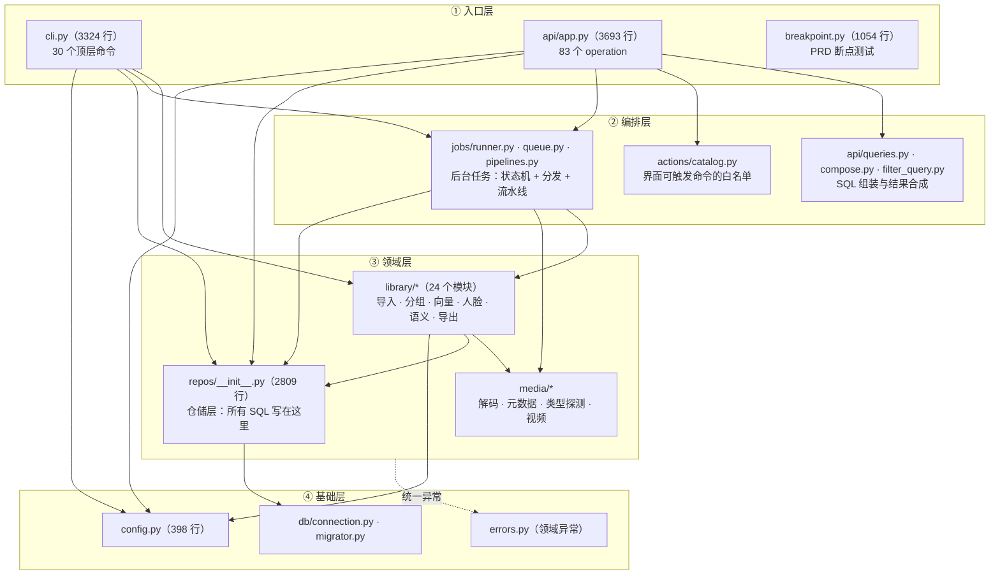
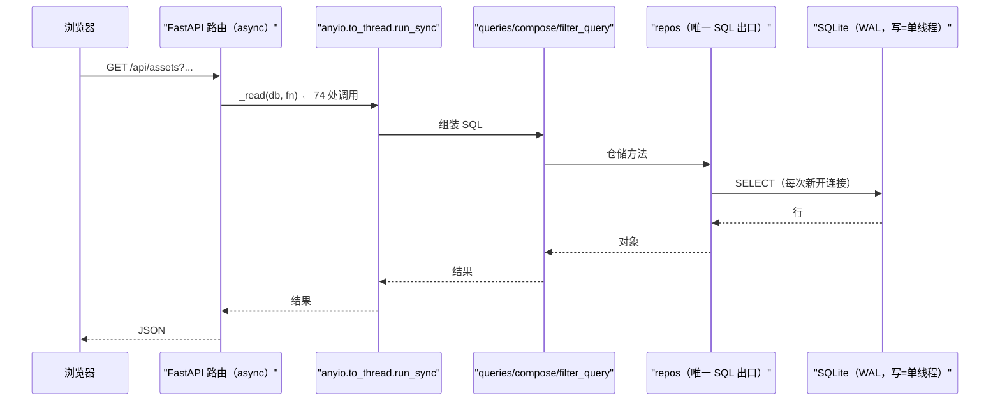

# 20 · 后端架构与模块地图

> 本篇回答：后端**分成哪几层**、**每个模块负责什么**、**一次请求在代码里怎么流动**。
> 表级细节看 [`12-数据模型与迁移.md`](12-数据模型与迁移.md)；
> 逐接口清单看 [`40-HTTP接口参考.md`](40-HTTP接口参考.md)；任务机制看 [`31-任务引擎与流水线.md`](31-任务引擎与流水线.md)。

---

## 1. 分层与依赖方向

> 【实测】各层规模与出处：`cli.py` 3324 行 / 30 个顶层命令（`--help` 实测）；
> `api/app.py` 3693 行 / 84 个装饰器（去重 83，见 §3）；
> `repos/__init__.py` 2809 行；`library/` 24 个模块、`media/` 4 个。
>
> 【推断】依赖方向是**单向向下**的：`cli`/`api` 不互相依赖，二者都依赖
> `library`/`jobs`/`repos`；`media` 谁都不依赖（只被 `library`/`jobs` 调）；
> `db`/`config`/`errors` 在底部。这条方向没有用工具强制，靠人工遵守 ——
> 所以"新增模块该放哪一层"是本篇最主要的用途。

---

## 2. 模块地图（按职责，不按目录）

### 2.1 入口层

| 模块 | 行数 | 职责 | 关键点 |
| --- | --- | --- | --- |
| `cli.py` | 3324 | 30 个命令的 argparse 定义与实现 | `_force_utf8_io()` 保证 Windows 控制台能显中文（硬规则 I-7） |
| `api/app.py` | 3693 | FastAPI 装配、全部路由、静态托管、异常映射 | lifespan 里启停后台执行器（`:259-287`） |
| `breakpoint.py` | 1054 | PRD §9.1 断点测试与报告 | 需要真实照片库，默认不快跑 |

### 2.2 编排层

| 模块 | 行数 | 职责 |
| --- | --- | --- |
| `jobs/runner.py` | 1038 | 后台执行器：认领、执行、进度、取消、重启恢复 |
| `jobs/queue.py` | 436 | 任务表读写：入队、认领、完成、失败、`JOB_TYPES` 白名单 |
| `jobs/pipelines.py` | 622 | 各任务类型的实际流水线（`run_discovery`/`run_hash`/`run_metadata`/`run_previews`/`run_fused_hash_previews`，`:88,157,219,305,409`） |
| `actions/catalog.py` | 392 | 界面命令白名单（16 条）+ 依赖探测 + 解释器选择 |
| `api/queries.py` | 1110 | 资产/分组/统计的 SQL 组装 |
| `api/compose.py` | 571 | 把多个来源的筛选结果**合成**一个结果集 |
| `api/filter_query.py` | 347 | 结构化筛选字段 → SQL 片段 |
| `api/structured_find.py` | 119 | `photoos find` 的确定性取片 |

> 【推断】`compose.py` **没有 DSL、没有解析器** —— 它是"把若干已算好的子句合并"的
> 合成器，不是查询语言。而界面上那条"条件条"是**纯前端只读投影**
> （`web/js/query_bar.js`），不存在"查询字符串 → 后端解析"这条链路。

### 2.3 领域层

| 模块组 | 模块数 | 职责要点 |
| --- | --- | --- |
| `library/` 导入与索引 | `importer` `walker` `volume` `store` `rebind` `migration` `paths` | 扫描、BLAKE3 哈希、卷身份、换盘重绑、迁移包、**相对路径安全** |
| `library/` 分组 | `classify` `classify_import` `session_derive` `shot_grouping` `scene_grouping` `geo` | 目录/城市/时段归类 → Shot → Scene（确定性规则优先） |
| `library/` 精选与主题 | `selection` | 四态状态机（与 AI 无关） |
| `library/` AI | `embedding` `embedding_gemma` `embed_pipeline` `vectorstore` `model_store` `faces` `semantic_rank` | 见 [`50-AI子系统.md`](50-AI子系统.md) |
| `library/` 其他 | `export` `repair`… | 打包原片、修复派生数据 |
| `media/` | `adapter` `metadata` `detect` `video` | 解码、元数据抽取、类型探测、视频 |
| `repos/__init__.py` | 1 个文件 | **所有 SQL 写在这里**（2809 行） |

> ⭐ 【实测】`repos/` 是**单文件**（2809 行）且名字误导：它不是"每个实体一个仓储"，
> 而是一个巨型模块里放了 `AssetRepo`/`ShotRepo`/`SelectionRepo`/`CollectionRepo`/
> `PeopleRepo`/`SemanticRepo`/`PreviewRepo` 等类。
> 【推断】好处是"SQL 只有一处"，坏处是**并发修改极易冲突**（本轮文档工作中，
> 多个调查任务都读它）。要不要拆，属于结构决策。

### 2.4 基础层

| 模块 | 职责 | 关键点 |
| --- | --- | --- |
| `db/connection.py` | 连接与 PRAGMA | 每次查询新开连接；WAL；写事务 `BEGIN IMMEDIATE`（**单写线程**） |
| `db/migrator.py` | 迁移应用与校验 | 见 [`12-数据模型与迁移.md`](12-数据模型与迁移.md) §8 |
| `config.py` | 配置解析 | 优先级：构造参数 > `PHOTOOS_*` 环境变量 > `data/config.json` > 默认 |
| `errors.py` | 领域异常 | 由 `api/app.py` 翻译成带稳定 `code` 的 HTTP 响应 |

> ⚠️ 【实测】`photoos.toml` **不是配置来源** —— 它只是**项目根标记**
> （`config.py:34,62-72`，`find_project_root` 靠它定位）。
> 【推断】项目文档把它与 `config.json` 并列陈述，容易让人以为改它能改行为（见 Q-25）。

---

## 3. 一次请求怎么走（代码级）

* 【实测】`_read()` 是 `anyio.to_thread.run_sync` 的薄封装（`api/app.py:3395-3404`），
  全后端 **74 处**调用。理由写在 docstring："SQLite 是同步库，直接在 async 路由里调用
  会阻塞整个服务"。
* 【实测】`Database` 只持有路径，**每次查询新开连接**；写事务用 `BEGIN IMMEDIATE`
  → 实际是**单写线程**模型。

### 3.1 错误映射（三层，写接口时按这个来）

| 层 | 触发 | 响应形状 | 状态码 |
| --- | --- | --- | --- |
| 兜底 | 任何未预期异常 | `{message, detail}` | **500**（堆栈进服务端日志） |
| 校验 | `RequestValidationError` | `{detail}` | **422** |
| 领域 | `PhotoOSError` 子类 | `{code, message, detail}` | 404 = `LibraryNotFound`/`JobNotFound`；503 = `NotInitializedError`；其余 **400** |

* 【实测】兜底处理器存在的原因有真实现场（`api/app.py:289-307`）：
  某个局部 `except` 用了未导入的名字，于是任何错误都变成裸的 `Internal Server Error`，
  界面上完全看不出原因。
* 【实测】422 处理器做过一件特别的事（`app.py:310-322`）：把非有限浮点**转成字符串**，
  因为 FastAPI 默认会把请求体原值放回错误响应，而 JSON 里没有 `NaN`/`Infinity` ——
  客户端发 `1e400`（合法 JSON，Python 解析成 `inf`）时默认处理器自己就序列化失败，
  用户看到 **500** 而不是 422。
* 【实测】路由内另有几处专用状态码：**428**（需要二次确认）、
  **501**（保留的浏览轴）、**409**（离线 / 已退役）。

---

## 4. 后端结构里值得注意的五个事实

### 4.1 `job.type` 有代码常量兜底，`app_event.kind` 没有

* 【实测】`jobs/queue.py:24-49` 定义 `JOB_TYPES`（**14 种**），入队时校验（`:130-131`）。
* 【实测】`app_event.kind` 的唯一入口 `library/store.py:392-401` **不做任何校验**，
  直接 INSERT → 可写任意字符串（Q-8）。

### 4.2 分发是"内联 dict 字面量"，不是注册表

* 【实测】任务类型 → 流水线的映射在 `jobs/runner.py:144-162` 是**一个内联 dict**，
  没有 `match`/`if-elif`/装饰器注册。
* 【推断】好处是"一眼看全"，代价是**新增任务类型要改两处**
  （`queue.py` 的常量 + `runner.py` 的 dict），漏一处会在运行期才暴露。

### 4.3 排序白名单有**四份**且已经漂移

* 【实测】`recent` 在 `queries.py`/`filter_query.py` 里是 `m.extracted_at`，
  在 `compose.ASSET_ORDERS` 里是 `a.first_seen_at` → `/api/filter?order=recent`
  会**静默按 capture 排**。
* 【推断】这是本轮发现的质量最高的结构性隐患之一：**同一个词在两个入口含义不同，
  且不报错**。→ Q-26。

### 4.4 `_collection_clause` 逐字重复定义了两遍

* 【实测】`api/filter_query.py:150-165` 与 `:243-258` 是同一段逻辑的两份拷贝，
  **后者生效**（Python 后定义覆盖前者）。
* 【推断】改前一份**没有任何效果** —— 典型的"改了没反应"陷阱。

### 4.5 `retired_at` 的筛选口径在 asset 级与 shot 级不一致

* 【实测】shot 级查询筛 `retired_at IS NULL`；而 **asset 级路径**
  （`asset_page`/`structured_query`/`combine_assets`/`asset_detail`）**完全不筛**。
* 【推断】无法从代码判定这是**刻意**（asset 是事实、不该被隐藏）还是**遗漏**。
  由于活库当前 `retired_at IS NULL` 恒真，**这个差异在真实数据上还没有暴露** ——
  一旦有组被重算退役，界面可能就会多出"看不见的"照片。→ Q-27。

---

## 5. 想改后端时，先看这一节

| 你要做的事 | 该动哪里 | 别忘 |
| --- | --- | --- |
| 加一个接口 | `api/app.py`；SQL 放 `queries.py`/`compose.py`；**不要**在路由里写裸 SQL | 走 `_read()` 线程池；错误用 `PhotoOSError` 子类 |
| 加一个后台任务 | `jobs/queue.py` 的 `JOB_TYPES` + `jobs/runner.py:144-162` 的分发 dict + `jobs/pipelines.py` 的流水线 | **两处**都要改 |
| 加一条界面能跑的命令 | `actions/catalog.py` 的 `CATALOG` | 浏览器只能提交 id；参数模板里不能含用户输入 |
| 改数据库 | 新增迁移文件（**不改已发布的**） | 见 `12-数据模型与迁移.md` §8 |
| 加一个筛选维度 | `api/filter_query.py` + 前端条件条 | 注意 §4.4 的重复定义 |
| 改前端资源 | `web/` 下源码树（可编辑安装直接读源码） | 静态资源是 `no-cache`，**刷新即生效**；后端改动**必须重启** |

---

## 6. 本篇引出的疑问

| 编号 | 一句话 |
| --- | --- |
| Q-25 | `photoos.toml` 不是配置来源，但文档把它与 `config.json` 并列 |
| Q-26 | 排序白名单四份且漂移（`recent` 两处含义不同，静默改变排序） |
| Q-27 | asset 级查询不筛 `retired_at`，shot 级筛 —— 刻意还是遗漏？ |
| Q-28 | `collection_id` 非数字 → `int()` 抛 `ValueError` → **500 而非 400** |
| Q-29 | `year` 传整数静默 0 行（缺 `f"{int(year):04d}"` 强转，另两处都强转） |
| Q-30 | `_collection_clause` 重复定义两份，后者生效 |

---

返回 [`README.md`](README.md) · 下一篇：[`30-媒体与导入流水线.md`](30-媒体与导入流水线.md)
