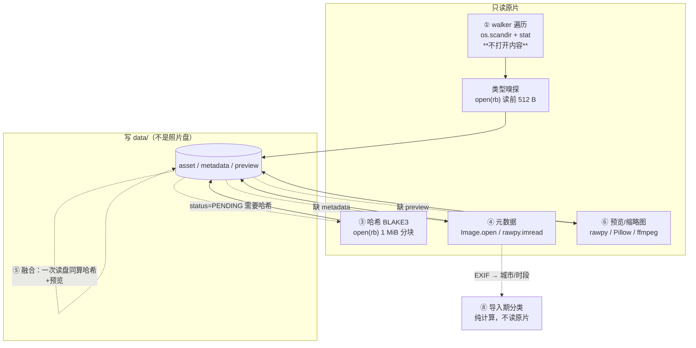
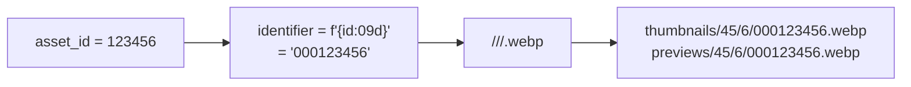

# 30 · 媒体与导入流水线

> 本篇覆盖**从磁盘上的文件到数据库里的一行**：扫描、哈希、元数据、分类、预览/缩略图、视频，
> 以及**"原片永不被碰"这条铁律的代码级取证**。
>
> 相关：[`31-任务引擎与流水线.md`](31-任务引擎与流水线.md)（这些步骤怎么被调度）、
> [`12-数据模型与迁移.md`](12-数据模型与迁移.md)（落成哪些行）。

---

## 1. 支持的格式

【实测】唯一真源是 `photoos/backend/photoos/config.py:139-159`。导入实际收进库的 =
照片 ∪ 视频，共 **41 个扩展名**：

| 类 | 数 | 扩展名 |
| --- | --- | --- |
| 照片 | 12 | `.jpg` `.jpeg` `.jpe` `.png` `.tif` `.tiff` `.webp` `.bmp` `.gif` `.heic` `.heif` `.avif` |
| RAW | 18 | `.nef` `.nrw` `.cr2` `.cr3` `.crw` `.arw` `.srf` `.sr2` `.raf` `.orf` `.rw2` `.pef` `.dng` `.srw` `.raw` `.rwl` `.3fr` `.iiq` |
| 视频 | 11 | `.mp4` `.mov` `.m4v` `.avi` `.mkv` `.wmv` `.mts` `.m2ts` `.mpg` `.mpeg` `.3gp` |

【实测】活库实际构成：`jpeg` **13,239** + `raw` **8,101**（全部 `.NEF`）+ `video` **60** = 21,400。

⚠️ 【实测】**一个路由缺口**：`.cr3` 与 `.raw` **在 `RAW_EXTENSIONS` 里，却没有 raw 解码路由**
（`media/detect.py:31-48,67-71`）→ 会被判成 `other` / `application/octet-stream`，
且**没有测试覆盖**。→ 已登记。

---

## 2. 完整流水线

> 【实测】虚线表示"**只有这些步骤需要打开原片**"。`full_index` 的阶段顺序是：
> **发现 → 元数据 → 预览 → 融合（哈希+预览）→ 哈希兜底 → 预览兜底 → 重复报告 → 分组**
> （`jobs/runner.py:883-966`）；顺序理由写在注释里：**"让用户尽快看到东西"**（`:884-887`）。
> 发现阶段按 `DISCOVERY_BATCH=400` 分批提交（`jobs/pipelines.py:31,134-144`）。

### 2.1 ① 遍历：只 stat，不读内容

* 【实测】`walker.walk_media()` 只做 `os.scandir` + `entry.stat()`，
  **从不打开文件内容**（`library/walker.py:85-93,175-176`）。
* 【实测】顺序稳定：目录内按 `name.casefold()` 排序；防目录环用 `realpath`+`normcase`
  记录已访问真实目录，回指时产出 `WalkError("检测到目录环，已跳过")`。
* 【实测】单文件失败**不中断整批**；产出 `relative` 已过 `paths.validate_relative`
  → **盘符永远不会成为照片的身份**（铁律 #2）。

### 2.2 库根识别：不靠盘符

* 【实测】判据强度分三级：① 库标记 `<root>\.photoos\library.json` 的 `library_uuid`；
  ② 同卷候选库顶层目录 **Jaccard 重合度**（阈值 ≥0.6 且交集 ≥2 且严格大于次优，
  否则**拒绝猜测**）；③ 卷序列号（**只缩小候选，不足以判定身份**）
  （`library/store.py:1-10,424-432,524-579`）。
* 【实测】卷指纹 = 抽样 `(相对路径, size, mtime_ns)` 排序取前 256 条做 SHA-256，
  **只含相对路径与元数据**（`store.py:134-144`）。
* ⚠️ 【实测】**标记文件是全项目唯一允许写进照片库的东西**（`store.py:94-130`，自称"唯一例外"）：
  `dry_run=True` 是默认、已存在**拒绝覆盖**、`tmp`+`replace` 原子写。

### 2.3 两条导入路径（**去重口径不同，注意**）

| | 通用导入 `library/importer.py` | 分类导入 `library/classify_import.py` |
| --- | --- | --- |
| 计划 / 执行 | `plan_import()` / `execute_import()` | `build_plan()` / `execute_plan()` |
| 目标路径 | 保持源相对结构（可加 `subdir`） | `<城市>\<时段>\<文件名>` |
| 复制实现 | `_copy_verified()` | **复用同一个** `_copy_verified` |
| 任务类型 | 无独立 job（CLI/接口直调） | `classify_import` job |

* 【实测】预演与执行**共用同一份计划**（`execute_import` 内部先调 `plan_import`），
  且**计划阶段只读源与库、不写文件**。
* ⚠️ 【实测】**去重口径不同**：`plan_import` 会查"库内其它路径是否已有同内容"
  （`known_hashes`），而分类导入**只按相对路径 + `(size, content_hash)` 判**
  → 同一张卡换一条路径导入，可能多出一份 `__2` 副本。
  审计文档记的隐含前提：去重依赖"库里那条已有 `content_hash`"，为空时会多导一份。

### 2.4 去重规则（四种情形）

| 场景 | 判据 | 结果 |
| --- | --- | --- |
| 目标同名、内容相同 | `size` 相等 **且** BLAKE3 相等 | `skip-duplicate` |
| 目标同名、内容不同 | 同上不等 | 改名 `__2`/`__3`…（**绝不覆盖**） |
| 库内其它路径已有同内容 | 计划期收集的 `known_hashes` | `skip-duplicate` |
| 分类导入的同名冲突 | `(size, content_hash)` 索引 + **冲突时才现算源哈希** | 同内容跳过／异内容 `__N` |

* 【实测】`_next_free_relative` 从 `__2` 试到 `__999`，找不到即**报错**（不静默覆盖）。
* 【实测】重复导入已被真实夹具钉住：首次 `copied=6`，再次
  `duplicates=6 skipped_duplicate=6 copied=0`（`docs/10-import-audit.md:14-19`）。

### 2.5 哈希在导入时就落库

* 【实测】`_copy_verified` 复制成功后返回源 BLAKE3，调用方**立即**
  `UPDATE asset SET content_hash, hash_algo`。理由写在代码里：
  复制时已经算过，顺带落库让"按内容去重"在导入期就生效，**也省一次全文件读**。

### 2.6 盘符变化（rebind）与盘不在

* 【实测】`probe_path()` 先用库标记命中已登记库；命中但路径变了 → `action="rebind"`
  （文案"盘符变化/换盘，需重绑定"）。
* 【实测】`rebind_library()` 三步：① 逐条 `is_file()` 纯 stat；② 抽样校验；③ **只改数据库**。
  抽样默认 **32** 条：有哈希抽哈希，否则退化 `size+mtime`，再退化 `path-only`；
  **哈希不一致 → 中止并明确告知**。
* 【实测】盘不在：`action="offline"`；`mark_library_offline()` 置
  `library.status='OFFLINE'` + 卷标 OFFLINE + 写 `app_event`。
* ✅ 【实测】**离线时原图/查看端点返回 409（不是 500）**，且详情里含"离线"
  （`tests/unit/test_original_access.py:193-205`）—— 这是"拔盘可用"承诺的代码级落点。
* 【实测】迁移包**不含原片**：`photo_files_included: False`；导入后提示执行 rebind，
  并在 `restore.json` 写回退步骤。

---

## 3. 铁律 #1 的代码级取证（**本节是最重要的**）

> 铁律原文（`photoos/README.md:17`）：
> **原片永不被动**：PhotoOS 不移动、不改名、不覆盖、不删除照片原文件。**删除数据库记录 ≠ 删除原文件。**

### 3.1 打开原片的**全部**代码路径（含打开模式）

| 位置 | 打开方式 | 目的 |
| --- | --- | --- |
| 遍历 | `os.scandir` / `stat`（**不打开内容**） | 列目录、取 size/mtime |
| 类型嗅探 | `open(path,"rb")` 读前 512 字节 | 魔数判定 |
| 哈希 | `open(path,"rb")` 分块 1 MiB | BLAKE3 |
| 元数据 | `Image.open(path)` / `open(path,"rb")` / `rawpy.imread(str(path))` | EXIF、尺寸、`flip` |
| 预览 | `rawpy.imread`+`extract_thumb()` / `Image.open(path)` / `ffmpeg -i <path>` | 解码 |
| mp4 探测 | `open(path,"rb")` + `seek` 逐 box 读 16 字节头 | 解析 `moov` |
| 文件身份 | `CreateFileW(GENERIC_READ, FILE_SHARE_ALL)` | Win32 file index |
| 导入复制 | 源 `open(source,"rb")` + **临时文件** `open(temp,"wb")` | 复制入库 |

* 【实测】上表**唯一以写模式打开的是目标临时文件**（`<target>.photoos-part`，
  位于库根的**新路径**），源始终 `"rb"`。
* 【实测】全包 `open(...,"w"/"wb"/"r+"/"a")` **只有 4 处**：
  `cli.py:564`（导出 CSV）、`library/geo.py:235`（地理缓存）、
  `importer.py:294`（上述临时文件）、`library/model_store.py:359`（模型下载）
  —— **无一处写模式打开原片**。
* 【实测】`write_text/write_bytes` 6 处，除"库标记的 `.json.tmp`"外全部落在
  `data_root` 或用户指定输出。

### 3.2 写入照片库的**唯二**路径

1. **库标记** `<root>\.photoos\library.json` —— 自称"唯一允许写入照片库的例外"
   （默认 dry-run、拒绝覆盖、原子写）。
2. **导入产生的新副本** —— `.photoos-part` → `fsync` → size 校验 → **BLAKE3 双端校验**
   → `os.replace` 原子改名；目标已存在直接 `SafetyError`；目标越出库根拒绝；
   **失败即删临时文件、不留半成品**。

* 【实测】"源不能位于库内部（会自我复制）"由 `paths.is_same_root` 守住。

### 3.3 钉住它的测试（8 条）

| 测试 | 钉住什么 |
| --- | --- |
| `test_processing_never_modifies_original` | 元数据+预览前后**整目录快照（size+mtime+内容）相等**（jpeg/png/tiff/heic） |
| `test_processing_never_modifies_real_nef` | 真实 NEF：`(size, mtime_ns)` 与前 1 MiB SHA-256 不变 |
| `test_execute_never_modifies_source` | 导入后源目录快照一致 + 文件名集合不变（"没有剪切"） |
| `test_failed_copy_leaves_no_partial_file` | 失败不留 `.photoos-part` |
| `test_copy_verified_refuses_existing_target` | 目标已存在即拒绝 |
| `test_apply_copies_byte_identical_and_leaves_source_untouched` | 分类导入逐字节相同、源未动 |
| `test_walk_does_not_modify_files` / `test_file_identity_does_not_modify_file` | 遍历与 `CreateFileW` 均不改文件 |
| `test_discovery…` / `…previews_pipeline_does_not_touch_originals` / `test_fused_does_not_modify_originals` | 发现/预览/融合三阶段各自不改原片 |

* 【实测】API 层另有路由级守卫（禁止"动原片"的端点），见
  [`70-安全边界与硬规则.md`](70-安全边界与硬规则.md) §5.2。

> ⚠️ 【实测】**一处数字过期**：`PHASE1_DELIVERY.md:146` 声称"backend 全部 **19 处**
> `shutil.move/os.rename/os.replace/unlink/rmtree` 中无一条触及原片"；
> 本轮 grep 实测是 **27 处**（类别一致、未发现触及原片者）。
> 【推断】结论不变，但那个数字该更新。

---

## 4. 元数据抽取

### 4.1 分层策略

| `file_type` | 主解析器 | 兜底 |
| --- | --- | --- |
| `raw` | **Pillow 读 EXIF（快且更全）** + rawpy 只补尺寸/方向 | exifread |
| `jpeg/png/tiff/heic/webp/other` | Pillow `getexif()` | exifread |
| `video` | 自写 ISO-BMFF 解析（mp4/mov/m4v/3gp）或 ffmpeg 头部文本 | — |

* 【实测】`source` 与 `source_enrichment` **分开记录主/补充来源**
  （活库实测：RAW 走 `libraw` 主体 + `pillow` 补充 = 8,101 行）。
* 【实测】**代码声称**（未复跑）：Pillow 能提供 `OffsetTimeOriginal`/`SubsecTimeOriginal`/
  `BodySerialNumber` 而 LibRaw 不提供，LibRaw 才给真实尺寸与 `flip`；
  成本对比 Pillow `getexif()` ≈ **2 ms/文件** vs `rawpy.imread()+extract_thumb()` ≈ **137 ms/文件**。
* 【实测】只读 IFD0 会漏曝光信息 → 先读 IFD0，再用 **Exif 子 IFD 覆盖**；
  `extract_metadata()` **永不抛异常**，失败写 `warnings`。

### 4.2 ⚠️ 两条"不猜"的纪律

1. **时区**：`capture_at` 只存**本地挂钟时间**；`capture_at_utc` **仅在时区已知时**写入。
   无时区 → `tz_source='unknown'` 且**显式加 warning**，**不伪造**。
   活库实测：`exif-offset` 21,340 / `unknown` 60（正好是那 60 个视频）。
2. **视频**：`mvhd.creation_time` 按规范是 UTC → 写 `capture_at_utc`、`tz_source='unknown'`，
   **不伪造本地时间**。代码注释明确写出与旧工具的差异：旧 PowerShell 工具对视频**硬编码 `+08:00`**，
   境外拍摄会算错。

### 4.3 ⚠️ IPTC / XMP **完全没有解析代码**

【实测】全包只有 EXIF（Pillow `getexif()`、exifread）与容器解析。
【推断】因此"关键词/版权/评级"这类 XMP 字段在 PhotoOS 里**不存在** ——
如果你的库里依赖过它们，那是功能缺口，不是 bug。

---

## 5. 预览与缩略图

### 5.1 常量

| 项 | 值 |
| --- | --- |
| 缩略图长边 / 预览长边 | **320** / **1600** |
| 格式 / 质量 | WEBP / **82**（缩略图与预览共用同一质量） |
| 生成器版本 | `p1.0` → 落 `preview.generator_version`（这是铁律 #4 的落点） |

* 【实测】缩放**只缩不放**；写入先落 `.tmp` 再 `os.replace` 原子替换。

### 5.2 存储布局：按 **asset_id** 分片（**不是内容寻址**）

⚠️ 【实测】**本项目流传很广的错误说法**：`docs/01-arch.md:49` 写"按 sha256 前两位分桶"。
**代码与磁盘都不是这样** —— `media/adapter.py:274-280` 的分片键是 **asset_id 补零**，
测试把 `thumbnails/45/6/000123456.webp` 钉死（`test_media.py:593-603`）。
`sha256` **只用于**卷指纹与迁移包清单。

【推断】这个错误之所以能长期存在：两种方案在"两级两位分片、目录名都是 `00`…`NN`"
这一点上**肉眼完全一样**，只有"目录名是内容哈希还是自增 id"不同 ——
而它决定了"同一张照片换一个 asset_id 之后能不能复用缓存"。

### 5.3 解码器路由与"内嵌预览快路径"

| 类型 | 解码器 |
| --- | --- |
| `raw` | rawpy/LibRaw（**fast_path=True**） |
| `heic` | pillow-heif/libheif |
| `jpeg/png/tiff/webp/other` | Pillow |
| `video` | ffmpeg |

* 【实测】RAW **优先取相机内嵌 JPEG**（`extract_thumb()`，decoder 标
  `"rawpy/LibRaw(embedded-preview)"`）；不可用或尺寸不足（门槛：内嵌长边 < `max_edge//2`，
  即 1600 预览要 ≥800 px）才退回**半尺寸去马赛克**。
* 【实测】管线**强制重建**（`run_previews` 传 `force=True`）：因为"目标集来自数据库缺记录"
  而适配器判据是"磁盘文件在不在"，两个口径不一致会**静默复用陈旧图**。
* 【实测】内存复用：`generate_previews_from_bytes()` 复用已为哈希读进内存的同一份数据，
  省掉"270 GB 再读一遍"；**视频不适用**（ffmpeg 按路径读）。

### 5.4 ⚠️ RAW 预览方向缺陷（**已定位、未修复**）

这是本项目**最重要的已知缺陷**，3,861 张受影响。

**所在代码**：`media/adapter.py:183` —— 把 LibRaw 的 `sizes.flip` 套在
**相机内嵌 JPEG** 预览上（实现 `:150-158`）。代码自己的理由写在 docstring：
"内嵌 JPEG 的 EXIF 方向未必可靠，以 LibRaw 为准"。

**为什么错**：LibRaw 作者明确说 `imgdata.sizes.flip` **只与 raw 数据有关**，
`unpack_thumb()` 抽出的 JPEG 是 **as is**（多数相机要么已转好、要么自带正确 Orientation）
→ 对已摆正的预览再转一次 = **二次旋转**。现场表现：`orientation=8` 的照片预览却 180° 颠倒、
**背景文字镜像**。

**影响面**（文档口径）：`orientation ∈ {6,8}` 共 **3,861** 张，其中 `file_type='raw'` 1,345 张。

**下游影响**（文档口径，逐模型实测过）：

| 模型 | 影响 |
| --- | --- |
| CLIP 内容检索 | **基本没有**（旋转后余弦中位 0.980–0.988，最低 0.803） |
| 人脸 SFace | **完全失效**（同一张脸正立 vs 倒转中位 **0.105**，36/36 张 < 0.3） |

⭐ **最该记住的一点**：这类错误**不报错**。检测器照样给 0.87 的置信度、框也框得正正好好，
只是特征崩了。日志干净、断言全绿，**只能靠把图下下来看**才能发现。

**修复计划**（顺序不可颠倒）：

1. 先核实内嵌预览自带的 EXIF 与 `sizes.flip` **谁可信**；
2. 改 `_apply_raw_flip` 的**调用条件**（内嵌预览路径不该按 `sizes.flip` 转）；
3. 只重生成那 3,861 张 preview/thumb；
4. 依次 `people detect` → `people embed` → `people learn`
   ⚠️ **不能只跑 `people embed`**：`face.landmarks_json` 存的是**检测坐标系**下的 15 个浮点，
   预览一转坐标系全变；
5. 视像素是否变化，再决定要不要 `scenes rebuild`。

**当前阻塞**：需要原片盘 `E:` 在线，而**本会话实测该盘离线**（`C:\Photos` 不可访问），
所以连第 1 步"核实"都做不了。

⚠️ 【实测】**第二处可疑代码**（尚未核实，修的时候**不要当既定事实**）：
`media/metadata.py:315-318` 把 LibRaw flip 映射成 EXIF 值（`{0:1, 3:6, 5:8, 6:5}`）给界面用；
文档认为该映射"很可能不对"。

⚠️ 【实测】`media/adapter.py` 里**没有任何 TODO/缺陷标记** —— 这个缺陷**只活在文档里**。
【推断】这正是它能一直没被修的原因之一：读代码的人不会知道这里有坑。

---

## 6. 视频（范围刻意很小）

* 【实测】范围由 PRD §9.1 锁定：**入库 + 基础信息 + 封面，不做内容分析**。
* 【实测】**不使用 ffprobe**：`imageio-ffmpeg` 随包只带 `ffmpeg`，
  所以 mp4/mov 的时长/尺寸/编码/创建时间由**自写 ISO-BMFF 解析器**得到。
* 【实测】`moov` 定位用**顶层 box 链表逐跳 seek**（每跳只读 16 字节），
  不用"头 N MB + 尾 N MB"窗口法 —— 真实样本（43 MB mp4）的 `moov`
  **落在两个窗口之外**。`moov` > 64 MB 则放弃容器解析。
* 【实测】只认 `hdlr=='vide'` 的视频轨，避免取到音频轨信息。
* 【实测】**封面帧**：在 `seek_seconds=1.0` 抽 1 帧到**临时目录**，再走**同一套 WebP 管线**
  （PNG 只是中转）。
* 【实测】ffmpeg 纪律：argv 列表传参（**不经 shell**）、显式 UTF-8 解码以支持中文路径、
  默认超时 120 s。
* 【推断】**不做的事**（代码里不存在）：抽多帧、转码、音频信息、字幕/章节、封面以外的内容分析。

---

## 7. 哈希与并发（**反直觉但都有实测依据**）

| 阶段 | 并发 | 代码声称的理由 |
| --- | --- | --- |
| **哈希** | **单线程顺序循环**（无线程池） | 受外置盘顺序读限制，实测该盘冷读仅 **55–71 MB/s**，并发只会加剧寻道；252 GB 库 ≈ 70–80 分钟 |
| **元数据** | 线程池，**按批次成分自适应**：RAW 占比 > 50% → **1 worker** | RAW 单线程 **2.2 文件/秒 > 6 线程 1.7 文件/秒**；JPEG 6 线程可达 900+ 文件/秒（缓存命中） |
| **预览** | 线程池，RAW 为主时收到 **2** | 纯单线程无法重叠 CPU 编码与 IO 读取；2 个 worker 改善重叠又不加剧寻道 |
| **融合** | 默认 **2** workers，一次 `read_bytes()` 同算哈希与出预览 | 分别跑会把 270 GB **读两遍**；融合吞吐约为单独跑预览的 2 倍 |
| **导入预演 EXIF** | 默认 **8** | 实测 1→5.0、2→9.5、4→15.8、**8→25.5**、12→30.8 文件/秒 |

* 【实测】哈希算法 **BLAKE3**，`READ_CHUNK = 1 MiB`，**整文件流式**（不整文件入内存），
  模块头声明"绝不写入或修改任何文件"。
* 【实测】`sha256`（大写）**仅**用于与既有 PowerShell 产物的一次性交叉校验。
* ⚠️ 【实测】`hash_workers` 配置项（默认 `max(2, min(8, cpu-2))`）**只用于 UI/CLI 展示** ——
  它**不影响**哈希阶段的行为（哈希固定单线程）。
* ⚠️ 【实测】**Windows 文件缓存让微基准不可靠**：同一路径两次测到 1525 与 1687 MB/s，
  而该 USB 盘冷读上限约 60 MB/s。代码自己声明了这一点。

---

## 8. 导入期分类（`<城市>\<时段>\<文件名>`）

【实测】`classify.py` 自称"**纯计算模块 —— 不读原片、不写文件、不碰数据库**"，
六趟判定：

| 趟 | 做什么 |
| --- | --- |
| pass 0 | GPS → 城市（网格直查 → 就近匹配 → 未解析） |
| pass 1 | 按时间切块（间隔 > `gap_hours` = **12 小时** 切段） |
| pass 2 | 块内按城市变化切分；段首无城市者**向后继承** |
| pass 3 | 整段无 GPS 时，**仅当**前后相邻已定位段城市一致且都在 **24 h** 内才推断 |
| pass 4 | 与库内既有锚点合并（间隔 ≤ `gap_hours` 且城市相符则沿用其目录） |
| pass 5 | 生成目标相对路径，同名加 `__N` |

* 【实测】规则来源是**复刻旧工具** `classify-photos.ps1` 的判定顺序与命名，
  并有一处**有意偏差**：旧实现在同城多锚点落在时间窗内时选"遍历顺序最后一个"，
  本模块改为"**同城优先 + 时间最近**"。
* 【实测】`city_override` 压过 GPS，并**列出"GPS 原本判成了什么"供核对**。
* 【实测】视频本地时间靠**同批次时间最近的照片**借 EXIF 偏移，理由：
  "那是**证据**，不是猜测"。
* ✅ 【实测】**关于 `gps-near` 的置信度**：`confidence_for_how()` 已经用正则
  `^(gps-near)\d+(?:\.\d+)?$` 剥掉距离尾巴再查表 —— 实测 `gps-near0.12 → 0.8`，
  **不会**落到兜底值 0.4。`classify.py` 那段"潜伏缺陷"的 docstring 记录的是**已修的历史**，
  不是当前行为（我上一轮把它当现存缺陷了，见 90 号文档 Q-41 的订正）。

### 8.1 重新分组怎么触发

* 【实测】任务类型 `regroup` 一次跑完三步且**顺序不能换**：
  `sessions backfill --apply` → `shots regroup --apply` → `scenes rebuild --apply`。
* 【实测】自动挂在两处末尾：`full_index` 与 `classify_import`；三步幂等，
  失败只记一条 stage、**不让索引失败**。
* 【实测】递归守卫：`_run_regroup` 经子进程跑 CLI，而 `photoos index --wait` 又会跑 `full_index`
  → 派生子进程时设 `PHOTOOS_SKIP_AUTO_REGROUP=1`。
* 【实测】导入**只建到 `session` 一层**，`shot`/`scene` 是**另三层派生**。

---

## 9. 本篇引出的疑问

| 编号 | 一句话 |
| --- | --- |
| Q-19 | 视频锚点时间：`_video_local_from_utc` 第二参数未使用，实际把 UTC 当本地时间 |
| Q-36 | `.cr3`/`.raw` 在 `RAW_EXTENSIONS` 里却**没有 raw 路由**，且无测试覆盖 |
| Q-37 | **IPTC/XMP 完全没有解析代码** —— 是刻意不做还是缺口？ |
| Q-38 | 两条导入路径**去重口径不同**（分类路径不查"库内其它路径同内容"） |
| Q-39 | `preview.kind='video_cover'` schema 允许但**没有写入者**（并入 Q-33） |
| Q-40 | `hash_workers` 配置项只用于展示，不影响哈希行为（易误读为可调并发） |
| Q-41 | ~~`confidence_for_how` 的 `gps-near` 尾部缺陷~~ → **已核实不是缺陷**（代码早就处理了） |

完整描述见 [`90-未解问题与待确认.md`](90-未解问题与待确认.md)。

---

返回 [`00-文档规范与索引.md`](00-文档规范与索引.md) · 相关：[`50-AI子系统.md`](50-AI子系统.md)（预览 → 向量）
