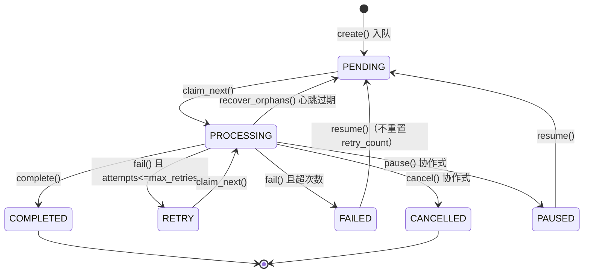

# 31 · 任务引擎与流水线

> 本篇覆盖**后台任务这一层**：任务怎么入队、被谁认领、怎么执行、进度怎么回浏览器、
> 取消/暂停/恢复与重启恢复怎么做，以及**14 种任务类型各自跑哪些步骤**。
>
> 相关：[`30-媒体与导入流水线.md`](30-媒体与导入流水线.md)（各步骤的实际内容）、
> [`40-HTTP接口参考.md`](40-HTTP接口参考.md)（`/api/jobs*`）、
> [`70-安全边界与硬规则.md`](70-安全边界与硬规则.md)（动作白名单的安全边界）。

---

## 1. 为什么要有一层任务

【实测】理由写在 `jobs/runner.py:4`：**"在后台线程里串行执行任务（一次一个），
每个任务内部自行决定并发度"**。

【推断】这一层的存在解决了三个具体问题：

1. **导入/索引会跑几分钟到几小时**，HTTP 请求不能一直挂着；
2. **进度要能看见**（用户得知道"还要多久"）；
3. **能中断、能续跑**（拔盘、关机、改参数都可能发生在中途）。

---

## 2. 数据模型

### 2.1 `job` 表（`001_core.sql:211-228`）

| 列 | 说明 |
| --- | --- |
| `id` | PK |
| `type` | 任务类型。⚠️ **无 CHECK 约束**；`:213` 的注释只列 7 种，**已过期**（实际 14 种） |
| `status` | **7 态，有 CHECK**：`PENDING`/`PROCESSING`/`COMPLETED`/`FAILED`/`RETRY`/`CANCELLED`/`PAUSED`（`:214-215`） |
| `scope_json` | 任务作用域（含 `library_id`） |
| `progress_done` / `progress_total` / `progress_note` | 进度 |
| `error` | 错误（截断 **2000**） |
| `retry_count` / `max_retries` | 默认 `0` / `3` |
| `priority` | 默认 `100` |
| `created_at` / `started_at` / `finished_at` / `heartbeat_at` | 时间戳。⚠️ `finished_at` **仅 FAILED 时写**（`CASE WHEN ?='FAILED'`） |
| `claimed_by` | **迁移 `004` 加的**（见 §4） |

索引 `idx_job_status ON job(status, priority, id)` —— 认领顺序就是它。

### 2.2 `job_item` 表：**断点续跑的单位**

`UNIQUE(job_id, ref_type, ref_key)`，索引 `(job_id, state)`。

⚠️ 【实测】`job_item.state` 的 5 个允许值里，**实际只写 `DONE`/`FAILED`**；
`PENDING` 来自 INSERT 默认值，而 **`PROCESSING` / `SKIPPED` 没有任何写入点**
（与 Q-33 的另两处"空转定义"同类）。

### 2.3 状态生命周期（7 个字面量，唯一写入者）

* 【实测】常量：`TERMINAL_STATUSES={COMPLETED,FAILED,CANCELLED}`、
  `ACTIVE_STATUSES={PENDING,PROCESSING,RETRY,PAUSED}`（`queue.py:51-52`）。
* 【实测】**没有 `JobStatus` 符号** —— 全仓用裸字符串。`JobReport.status` 的初值
  `"RUNNING"` 是**报告层的临时值**，不是 DB 状态。
* ⚠️ 【实测】一个易踩的坑：`max_retries=0` 的读回**必须判 `None` 而不是判假值**，
  否则 `0 or 3` → 3，会把"不重试"变成"重试 3 次"（`queue.py:417-421` 有特判）。
* 【实测】前端中文名一一对应：排队中/执行中/将重试/已暂停/已完成/失败/已取消
  （`web/js/actions.js:84-92`）。

---

## 3. 执行器：单线程串行

| 项 | 值 |
| --- | --- |
| 线程 | `threading.Thread(name="photoos-jobs", daemon=True)` |
| 任务级并发 | **1**（串行；全仓 grep `Semaphore` 无匹配） |
| 空闲轮询 | `idle_sleep = **1.0 s**` |
| 执行者身份 | `executor_id() = f"{socket.gethostname()}:{os.getpid()}"` |
| 启动顺序 | `start()` **先 `recover_orphans()`** 再起线程（幂等） |
| 停止 | `stop(timeout=5.0)`，由 FastAPI lifespan 的 `finally` 调用 |

* 【实测】**唯一的"同类不并行"是入队前查重**（`find_active`），不是执行期加锁。
* 【实测】**任务内并发**由各阶段自己决定：metadata/preview/fused 用 `ThreadPoolExecutor`，
  **hash 是单线程顺序**（理由是外置盘顺序读限制，见
  [`30-媒体与导入流水线.md`](30-媒体与导入流水线.md) §7）。
  RAW 占多数时 metadata 降到 1 worker、preview 降到 `min(2, workers)`。

### 3.1 分发：一个内联 dict

【实测】`runner.py:144-162` 是**内联 dict 字面量 + `.get(job.type)`**，
没有 `match`、没有 `if-elif`、没有注册装饰器。未知类型 → 抛
`PhotoOSError("…尚未在本版本实现")`。

【推断】代价是新增任务类型要改**两处**（`queue.py` 的 `JOB_TYPES` + `runner.py` 的 dict）。
✅ 好消息：**有测试双向对账** —— 用 `inspect.getsource` 反查分发字典的键与 `JOB_TYPES`
是否**双向相等**（`tests/unit/test_jobs.py:1158-1184`），漏一处会被测试拦下。

---

## 4. 多进程安全：`claimed_by` 与孤儿回收

### 4.1 为什么有这一列（迁移 004 的原始动机）

【实测】`004_job_claim_owner.sql` 的头注释记录了真实触发原因：

> `photoos serve` 的后台执行器与命令行里的 `photoos index` / `_full_index.py`
> **同时**从同一张 job 表认领任务……在只有 ~60 MB/s 的 USB 盘上等于**互相抢带宽、
> 重复读取同一批文件**。

修法：**只认领"无归属"或"归属自己"的任务**；其他进程留下的归属会在**心跳过期后**
被 `recover_orphans` 释放。

### 4.2 认领的原子性（一处**容易说错**的细节）

【实测】`claim_next()` 的原子性来自 **`BEGIN IMMEDIATE` + 同一事务内先 `SELECT`**，
**不是** `UPDATE … WHERE status='PENDING'` 这种形态 ——
它的 `UPDATE` 的 `WHERE` 里**只有 `id`**。

⚠️ 【实测】`PAUSED` **不在**认领的 `IN` 列表里 → **永不会被领**（这正是"暂停"的实现方式）。

### 4.3 孤儿回收

* 【实测】`recover_orphans(stale_after_seconds=300, owner=None)`：
  取全部 `PROCESSING` → 跳过"属于自己"的 → 心跳缺失或早于阈值视为过期
  （**解析失败也算过期**）→ 置回 `PENDING`、清 `claimed_by`、
  写 `error='进程中断，已自动恢复为待执行'`。
* 【实测】调用点**只有三处**，且阈值不同：

  | 调用者 | 阈值 |
  | --- | --- |
  | `BackgroundRunner.start()`（服务启动） | **300 s** |
  | CLI `index --wait` | **60 s** |
  | CLI `photoos jobs recover` | **0**（立即） |

* ⚠️ 【实测】**运行期没有周期性回收** —— 主循环里只有 `claim_next`。
* ⚠️ 【推断】**所以"崩溃后立刻重启"并不会恢复任务**：上一进程的心跳距今 < 300 s，
  该行不会被回收，会**停在 `PROCESSING`** 直到再次重启或手工 `photoos jobs recover`。
* ⚠️ 【实测】回收**不递增 `retry_count`**，与 `docs/04-jobs.md:56` 写的"attempts+1"矛盾，
  且**测试没有断言**（→ Q-31）。
* ⚠️ 【实测】**窄竞态**：`run()` 在 `runner.py:179` 读一次 `is_cancelled`；
  若取消请求恰好落在这行与 `:184` 的 `complete()` 之间，
  **无状态守卫的 `complete()` 会把刚写的 `CANCELLED` 覆盖成 `COMPLETED`**。
* ⚠️ 【实测】**`PENDING` + 遗留 `claimed_by` 死结**：`resume()` 不清 `claimed_by`，
  而回收只扫 `PROCESSING` → 该行**没有任何执行者会认领它**（→ Q-32）。

---

## 5. 进度、取消与暂停

### 5.1 进度是**条目计数**，不是步骤数

【实测】语义由各阶段自设：hash 每 **25** 条、metadata 每 **50**、preview 每 **25**、fused 每 **25**。

⭐ 【实测】一个精巧的设计：`update_progress()` 的 `sets` **总是含 `heartbeat_at=?`** ——
**"写进度 = 发心跳"**，因此**不需要独立的心跳线程**。

⚠️ 【实测】`cli_action` 用**输出行数**当 done 且 `total=0` → **percent 恒为 0**，
界面只能显示"已输出 N 行"的流动条。
⚠️ 【实测】`settings.jobs_dir` 被定义与创建，但**没有任何写入点** →
**没有 per-job 日志文件**。

### 5.2 取消/暂停是**协作式**

* 【实测】`should_stop() = is_cancelled or is_paused`；检查点密布在各阶段之间与循环内
  （`full_index` 阶段间、`classify_import` 逐文件、`regroup` 逐条、
  `cli_action` **每行输出**、`export` 逐张）。
* ⭐ 【实测】**外部命令的"暂停" = 终止进程**。理由写在代码里：
  "**与其假装暂停（其实还在烧 CPU），不如停掉并让任务留在 PAUSED，
  用户点'继续'就重跑一次**"（`_terminate`：terminate → 等 5 s → kill）。
* 【实测】终态任务再取消/暂停会抛 `JobNotCancellable`。

---

## 6. 14 种任务类型与它们的步骤

| 类型 | 流水线步骤（按序） |
| --- | --- |
| `scan` | `run_discovery`（遍历 + 批 400 提交 + `mark_missing`）→ `log_event` |
| `hash` | `run_hash` → `build_duplicate_report` → `log_event` |
| `metadata` | `run_metadata`（workers = `effective_preview_workers`） |
| `preview` | `run_previews`（支持 `limit`/`force`/`scope_prefix`） |
| `fused` | `run_fused_hash_previews`（**一次读盘同时算哈希 + 出预览**） |
| `full_index` | discovery → metadata → preview → **fused** → hash(兜底) → preview(兜底) → 重复报告 → `regroup`（失败只记 stage） → `log_event` |
| `classify_import` | `build_plan` → `execute_plan` → 逐库 `run_previews` → `regroup` → `log_event` |
| `regroup` | `sessions backfill --apply` → `shots regroup --apply` → `scenes rebuild --apply`（**顺序不能换**） |
| `export` | `plan_export` → `build_archive`（带进度与停止检查）；**取消则删半成品** |
| `cli_action` | `subprocess.Popen([python,*argv])` → 逐行读输出写进度 → 非零退出抛错并附**末 12 行** |
| `rebind` | `rebind_library(..., sample=scope.sample or 50, apply=True)`；未 rebound 抛错 |
| `verify` | `library_availability` → 逐行进度（**离线不算失败**） |
| `backup` | `backup_database` → 可选 `prune_backups(keep)` → `log_event` |
| `migrate` | `verify_package` / `export_package`；**`action="import"` 显式拒绝**（要停机） |

### 6.1 `full_index` 的顺序理由

【实测】注释写着：**"让'用户尽快看到东西'优先：发现（秒级）→ 元数据/预览（可浏览）
→ 哈希（最慢）。每一步都检查暂停/取消，因此中断点即续跑点。"**

### 6.2 `regroup` 为什么走**子进程**（而不是把逻辑搬进来）

⭐ 【实测】理由写得很清楚（`:662-666`）：

> 这三步各自有完整的 CLI 实现……**直接把逻辑搬进来会形成第二份实现，两边迟早漂移。**

* 【实测】**命令参数全部由服务端写死**（不接受任何来自浏览器的拼接）。
* ⚠️ 【实测】**递归守卫**：`regroup` 经子进程跑 CLI，而 CLI 的 `index` 又会跑 `full_index`
  → 会无限递归。所以派生子进程时设 `PHOTOOS_SKIP_AUTO_REGROUP=1`。
  代码注释记着后果：**"接上自动分组之后，跑一次完整测试套件会挂死"**。
* ⚠️ 【实测】子进程**必须显式继承数据根**（`env["PHOTOOS_DATA_ROOT"]=…`），
  否则子进程会自己找项目根，**可能在另一个库上分组** ——
  注释原话：**"界面上什么都不会变（而且不会报错）"**。

---

## 7. 进度怎么回到浏览器：**纯轮询，没有流式**

* 【实测】服务端只有两个读端点：`GET /api/jobs`（带 `running_job_id`）
  与 `GET /api/jobs/{id}`（带 `items` 与 `failures[≤20]`）；`/api/health` 也带 `running_job_id`。
* 【实测】**没有 WebSocket / SSE / webhook** —— grep
  `WebSocket|EventSource|event-stream|webhook|callback_url` **全部无匹配**。
* 【实测】前端两档轮询：主轮询 **4000 ms**（刷健康 + 任务表）；
  等单个任务用自适应 **800 ms × 1.3，上限 4000 ms**，终态即停。
* 【实测】选择轮询而非流式的理由写在 `actions.js:56-62`：任务本来就在服务端跑、
  任务表本来就得靠轮询、**再开一条流式只会多一套要同步的状态**。

> 【推断】这条"够用就好"的取舍与前端"零构建"是同一套价值观：
> **在单机单人场景下，额外机制带来的同步成本大于它省下的延迟。**

---

## 8. 动作白名单（界面唯一的命令执行通道）

* 【实测】机制与安全边界见 [`70-安全边界与硬规则.md`](70-安全边界与硬规则.md) §3：
  浏览器**只能提交 action id**，命令模板/参数拼接/解释器全部由服务端决定。
* 【实测】16 条动作；`regroup` 用 `enqueue_job="regroup"` 走本任务系统而不是跑命令
  —— 因为它是多步的，"拆成三条命令会得到三个任务、三条进度，
  而用户在界面上按的是**一个**按钮"。
* ⚠️ 【实测】三处不一致（→ Q-34）：`/api/actions` 的 docstring 说返回 `argv`
  （实际只有 `command_preview`）；`regroup` 的 preview 与实际步骤不同；
  `fetch_face` 未标 `long_running`（它要下载模型）。
* ⚠️ 【实测】两个 action 端点**没有 HTTP 层测试**（→ Q-35）。

---

## 9. 想加一个后台任务时，按这个清单改

1. `jobs/queue.py` 的 `JOB_TYPES` 加类型名；
2. `jobs/runner.py:144-162` 的分发 dict 加处理器；
3. 需要新流水线就往 `jobs/pipelines.py` 加函数；
4. 需要进度就在循环里调 `on_progress(done, total, note)`（顺带发心跳）；
5. 需要可中断就在循环里调 `should_stop()`；
6. 跑 `pytest tests/unit/test_jobs.py -q` —— **双向对账测试会检查 1 和 2 一致**。

---

## 10. 本篇引出的疑问

| 编号 | 一句话 |
| --- | --- |
| Q-31 | 孤儿回收不递增 `retry_count`（与 `docs/04-jobs.md:56` 矛盾，测试也没断言） |
| Q-32 | `PENDING` + 遗留 `claimed_by` 死结，任务永远卡住 |
| Q-33 | `job_item.state` 的 `PROCESSING`/`SKIPPED`、`video_cover`、`jobs_dir` 三处"空转" |
| Q-34 | 动作目录三处不一致（含 `fetch_face` 未标长任务） |
| Q-35 | 两个 action 端点没有 HTTP 层测试 |
| Q-43 | **重启后 < 300 s 的孤儿不会被回收**，且运行期无周期性回收 |
| Q-44 | `complete()` 与 `cancel()` 的窄竞态（取消被 `COMPLETED` 覆盖） |
| Q-45 | `job.type` 数据库层**无 CHECK**（与 `job.status` 不一致），注释白名单已过期 |

完整描述见 [`90-未解问题与待确认.md`](90-未解问题与待确认.md)。

---

返回 [`00-文档规范与索引.md`](00-文档规范与索引.md) · 相关：[`41-CLI命令参考.md`](41-CLI命令参考.md)（`photoos jobs`）
