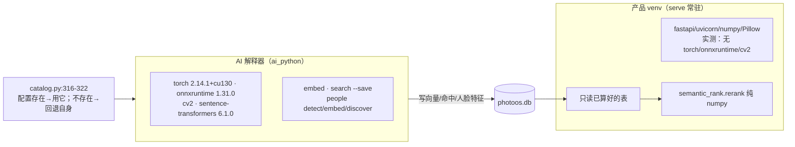

# 50 · AI 子系统（向量 · 人脸 · 语义）

> 本篇覆盖 PhotoOS 的全部机器学习能力：两套图像向量、中文文字检索、人脸检测/识别/聚类/学习、
> 场景相似度，以及**它们如何在一个故意不装框架的环境里运行**。
>
> 取证方式：本会话逐文件读代码 + 只读 SQL 复核活库 + 直接量磁盘权重（sha256/字节数）+ CLI 实测。
> 凡"代码注释声称的数字"都显式标注为**代码所述、未复跑**。

---

## 1. 两个向量空间（这是理解 AI 层的钥匙）

PhotoOS 里有**两套互不相通的图像向量**，各自有独立身份、独立用途：

| | CLIP（视觉） | EmbeddingGemma 2（EG2） |
| --- | --- | --- |
| `model` | `clip-vit-base-patch32` | `embeddinggemma-2` |
| `model_version` | `xenova-onnx-fp32` | `safetensors-fp32` |
| `prep_version` | `p1.0` | `eg2-p1.0` |
| 维度 / 归一化 | **512** / `l2` | **768** / `l2` |
| 运行时 | onnxruntime | torch + sentence-transformers |
| 落盘 | `ai_cache/models/clip-vit-base-patch32-xenova-onnx-fp32/vision_model.onnx` | `ai_cache/models/embeddinggemma-2-safetensors-fp32/model.safetensors` |
| 用途 | **Scene 划分的第 ② 步（相似度合并/细分）** | 中文文字检索的图像侧 + 重排候选池 |

> 【实测】身份来自代码（`library/model_store.py:39-45`、`library/embedding_gemma.py:50-55`）；
> 权重文件与代码钉住的 sha256 **全部 MATCH**：
> CLIP `vision_model.onnx` = 351,685,709 B、EG2 `model.safetensors` = 1,488,915,288 B。
> 【实测】活库 `embedding` 表两套并存：CLIP 512 维 **21,400** 行 + EG2 768 维 **21,400** 行 = 42,800。
> 【实测】维度不是只有代码注释：磁盘 `config.json` 里 CLIP `projection_dim=512`；
> EG2 `text_config.embedding_dim=768` 且 `vision_config.hidden_size=768`，
> `1_Pooling/config.json` 的 `embedding_dimension=768`。

### 1.1 中文检索为什么能跨"文字→图像"

**结论：不是投影、不是适配器，而是"同一模型身份下的同一空间"设计。**

【实测】机制只有两条，**没有任何中间映射层**：

1. 查询词用 EG2 文本塔编码成 768 维（`embedding_gemma.py` 的 `encode_texts`），
   检索就是**直接点积**：`NumpyVectorStore.knn` 做 `matrix @ vector`
   （`library/vectorstore.py:184-189`）。
2. 唯一的"对齐机制"是**身份过滤 + 维度硬校验**：先按 `model/model_version`
   从库里查出实际存在的 `prep_version`（`library/semantic_rank.py:116-133`），
   再在维度不匹配时**直接抛错而不广播**（`semantic_rank.py:247-251`）。

> ⚠️ 【实测】CLIP **只下载 vision tower，没有文本塔**（`model_store.py:48-61`，
> 注释写"本期不需要文本塔，省下 242.3 MB"）。因此**"用 CLIP 做英文检索"没有实现路径** ——
> ~~而 `actions/catalog.py:115` 的动作描述里写着"英文检索"~~ → **本轮已改文案**（Q-10）。
> 【实测】另一条口径纪律：`kind="query"` 与 `kind="document"` 用**不同的文本前缀**，
> 换前缀必须同时改 `PREP_VERSION`（`embedding_gemma.py:165-172`）。

---

## 2. 环境隔离：为什么服务端"没有 AI"



* 【实测】AI 能力全部在**可选依赖**里（`pyproject.toml:37-74` 的 `ai-cpu` / `ai-gpu`），
  基础依赖一个都没有（`pyproject.toml:15-28`）。
* 【实测】产品 venv 实测**确实没有** torch / onnxruntime / cv2 / sentence_transformers；
  AI 解释器是 `C:\PhotoOS\venv\Scripts\python.exe`（`data/config.json` 的 `ai_python`）。
* 【实测】服务端只读已算好的结果 —— 文字搜索接口注释明写
  "所以 **`serve` 不需要 onnxruntime/torch**，也不和 CLIP 抢显存"（`api/app.py:1206-1209`）。
* 【实测】EG2 **没有 ONNX/GGUF 产物**，只能走 torch，无法退化成 onnxruntime 路径
  （`model_store.py:102-108`）—— 这是"为什么必须有两个解释器"的根本原因。

### 2.1 缺依赖时绝不静默产出垃圾

* 【实测】`NullEmbedder` 在**调用时**抛 `EmbeddingNotAvailable`，理由写在代码里：
  "如果返回零向量，相似度会全部变成 0，用户看到的是'所有照片都不像'"
  （`library/embedding.py:156-183`）。
* 【实测】启动警告只在"`import onnxruntime` 失败**且**数据根下已有模型目录"时触发
  （`cli.py:840-845`），且**刻意不跑 `ai doctor`**（会真跑推理）以免拖慢启动。
* ⭐ 【实测】该警告的措辞被**订正过**：原文说"依赖视觉相似度的功能会退化为纯时间规则"
  实测**不成立** —— 因为 `scenes rebuild` 读的是**库里已有的向量**、只用 numpy
  （真实库实测 303 个 Scene，`--no-similarity` 是 371）。这段订正留在 docstring 里
  （`cli.py:828-834`），是"把前提当事实"被纠正的又一个现场。
* 【实测】计数分两个数（参与 Scene 的 CLIP 向量数 vs 全表向量数），
  注释说明原因："全表计数会把两个模型加在一起，于是启动提示会谎报 42,800"（`cli.py:866-889`）。

---

## 3. 人脸链路

### 3.1 检测 → 特征 → 聚类 → 学习

* 【实测】检测 `yunet-2023mar`、识别 `sface-2021dec`（128 维）、对齐口径 `sf-112-align-p1.0`
  （`library/faces.py:53-59`）。`model_version` = `cv2-<版本>-fp32`，理由：
  YuNet 前后处理随 OpenCV 版本变动（`faces.py:100-115`）。
* 【实测】检测只读 preview，把长边缩到 `DETECT_MAX=900`，检出后用 `1/scale` 还原框
  （`faces.py:254-287`）。
* **聚类不用单链**：实测"阈值 0.363 时 905 张脸里最大簇 686 张（76% 全并一起）"
  （`faces.py:399-401`）→ 改用 **kNN 图（k=8）+ Chinese Whispers（40 轮，seed 固定）**
  （`faces.py:395-458`）。k=8 的选择有合成数据依据（k=4 碎成 12/8/4，k=12 并成 13/11 不均）。
* **原型学习**：用户确认的样本权重 ×2、模型提议 ×1，加权均值后 L2 归一化
  （`faces.py:610-664`）；**不做微调**，理由有三（千级样本训不动、微调破坏可复算性、
  原型学习即时可重算）。
* ⭐ **阈值用留一法**（`faces.py:628-635`）：因为自我打分虚高 ——
  实测某簇用 5 张种子学出阈值 0.845，召回从 100% 掉到 56%；另一簇从 49% 掉到 **0%**。
  规则只有一条：在所有候选切点里选**平衡准确率最高**者，并列取更低。

### 3.2 质量判据都是比值（因此与缩放无关）

| 判据 | 阈值 | 定义 |
| --- | --- | --- |
| `symmetry` ≤ | 0.16 | `|鼻尖x − 两眼中点x| / 眼距` |
| `eye_ratio` ≥ | 0.30 | `眼距 / 脸宽` |
| `face_px` ≥ | 40 | `min(w, h)` —— **注意坐标系，见 3.3** |

> 【实测】`is_frontal` 的定位被明确写成"**只是缩小参与聚类的集合**，
> 不是一个'这张脸好不好'的评价"（`faces.py:159-161`）—— 因为侧脸参与聚类会让算法
> "按拍摄角度分组"。没通过的脸仍作为候选留给用户。

### 3.3 ⚠️ 坐标口径：三处说法互相矛盾，数据能裁定

【实测】本项目自己的三处说法**不一致**：

| 来源 | 说法 |
| --- | --- |
| 迁移 `008_phase4_people_review.sql:34-38` | `box_*` 与 `landmarks_json` **全部是原 preview 像素**（已还原检测缩放） |
| `faces.py` docstring 表格 | 把 `face_px` 归到"preview 原始像素" |
| 代码本体 | `box_w = values[2] * inverse`（还原到 preview），而 `face_px = min(values[2], values[3])`、`landmarks_json` 原样 `json.dumps(det15)` → **后两者是检测坐标系** |

【实测】**本会话用活库数据独立裁定**，三个比值同时等于 0.5625：

```
median(landmarks_json[2] / box_w)        = 0.5625
median(face_px / min(box_w, box_h))      = 0.5625
detect_max / max(preview_w, preview_h)   = 900 / 1600 = 0.5625
```

→ 结论：**`box_*` 是 preview 像素，`landmarks_json` 与 `face_px` 是检测坐标系（长边 900）**。
迁移 SQL 的注释与 `faces.py` 表格里 `face_px` 那一行**都是错的**。

**实际影响（【推断】，量级可算）**：`FRONTAL_FACE_PX_MIN = 40` 作用在检测坐标系上，
等于"1600 px 长边的 preview 上约 **71 px**"，比字面读起来**更严格**。
这不影响正确性（判据一致地用在同一个坐标系里），但会让**文档读者**误判阈值松紧。
→ 登记为 Q-9；修复只需改注释，属文档级修补。

### 3.4 "不是人"与反例都是一等事实

* 【实测】`person_reject` 是**独立表**，让"不属于"成为一等事实（`008:134-141`）。
* 【实测】"不是人"（`face_verdict`，只允许 `not_person` 一个值）**不删脸**，理由：
  "检测器确实在这里检出过一张脸，那是事实"（`api/app.py:2251-2293`）；
  **撤销必须存在**，因为"误判一张脸太容易了"。被标记的脸**不参与聚类与建议池**。
* 【实测】活库：`person_reject` 341 行、`face_verdict` 68 行、39 人（11 已命名）、
  `person_face` 正例 1,082 用户 + 613 auto。

---

## 4. 语义重排与反馈

```
基础分 = cos(图像向量, 词的文本向量)      ← 模型原始判断，存 semantic_query_hit
正例分 = cos(图像向量, 选中的照片均值向量)
反例分 = cos(图像向量, 删掉的照片均值向量)
最终分 = 基础分 + α·正例分 − β·反例分      α=0.35  β=0.25
```

* 【实测】最少 **2 条**反馈才激活（`MIN_FEEDBACK = 2`）；正/负例用**均值**而非最大相似度
  （抗单张误点、可复算）（`library/semantic_rank.py:41-46,181-212`）。
* 【实测】**硬排除优先于打分**：`drop` 的 shot 直接跳过；`keep` 但没排进前 N 的
  **必须**出现在结果里（`semantic_rank.py:259-288`）。
* 【实测】返回同时带 `score` 与 `base_score`，让用户看出"学习改变了什么"。
* 【实测】α 有一个**可算的上界**并被测试钉住："两个候选只有在原始分差小于 α 时才可能被翻盘"
  （`test_learned_tuning_cannot_override_a_large_base_gap`）。
* 【实测】原始结果**永不覆盖**：重排只发生在读取端，`semantic_query_hit` 保留模型当时的判断；
  界面上可以关掉学习看原样。

### 4.1 与 PRD §9.2（不许"替你选"）的距离

【实测】项目在**七处**明文把相似度限定为"排序依据/核对用"，例如
CLI 输出"**这不是'AI 替你选'**：只把候选集从全库缩小……输出里没有评分、没有'最佳'"（`cli.py:1762-1769`）、
前端"卡片上不出现评分、星级、'最佳'这类话术"（`search.js:6-9`）、
人物页"阈值/余量是机器用来划线的数，**不是给用户打分的**"（`people.js:17-20`）。

⚠️ 【实测】**最接近红线的一处**：`concept_ratio`（凝聚度）——`GET /api/semantic/queries`
**按凝聚度降序**返回候选搜索词，CLI 有 `--min-ratio` 过滤。
【推断】它排的是"**词**"（越靠前越"库里真有内容"），不是照片也不是人，不产生对用户的评价；
但这是 AI 子系统里唯一"按分数排序并过滤"的面向用户的列表。→ Q-12。

---

## 5. Scene 相似度（CLIP 驱动）

| 步 | 规则 | 常量 |
| --- | --- | --- |
| ① 时间断点（**总是执行**） | 相邻间隔 > `gap_seconds` 处切段；任一侧无时间则保守切断 | `DEFAULT_SCENE_GAP_SECONDS = 900`（15 分钟） |
| ② 相似度合并 | 跨边界 `bridge = cos(前一Shot末张, 后一Shot首张)` ≥ 阈值则合并 | `DEFAULT_MERGE_THRESHOLD = 0.85` |
| ② 相似度细分 | 段内**连续 8 张**与前一张相似度 < 0.5 → 在此处切 | `DEFAULT_DISSIMILAR_RUN = 8`、`0.5` |
| ③ 规模约束 | 段内 Shot 数 > `max_shots` → 在**最大时间间隔**处继续切 | `DEFAULT_MAX_SHOTS = 60` |

* ⭐ 【实测】跨组相似度取**两组资产两两余弦的最大值**，不是"相邻那一对" ——
  理由："Shot 内部的排列是拍摄顺序，不是相似度顺序……只看边界那一对会**系统性低估**相似度"
  （`library/scene_grouping.py:195-198`）。
* 【实测】**没有向量时第 ② 步整段跳过**（合并与细分两处都有 `if similarity is not None` 守卫），
  只做 ①③，"**不猜、不默认成 1.0**"。
* 【实测】③ 刻意**不用相似度**："按相似度切会让这一步与第 ② 步耦合，
  用户调相似度阈值时规模就不可预测了"。
* ⚠️ 【实测】该函数注释记录了一次**真实缺陷**：第 ② 步早就实现并单测通过，
  但 `scenes rebuild` 一直传 `similarity=None`，于是"相似度切片"在真实流水线里**从来没跑过**
  （`cli.py:2754-2757`）。**这是"测试全绿但功能没接线"的典型**。
* ⚠️ 【实测】`SceneParams.to_json()` 声明了 5 个配置键，但 `Settings` 里**一个都没有**，
  CLI 也只传 `gap_seconds` 与 `max_shots` → 用户**无法调** `scene_merge_similarity` /
  `scene_dissimilar_run` / `scene_unrelated_similarity`。→ Q-11。

---

## 6. 确定性分组（AI 层的地基）

### 6.1 Shot：只用时间 + subsec

* 【实测】唯一硬切分条件是"相邻两张间隔 > `gap_seconds`"；
  **镜头/焦段/曝光/序号一律不参与切分**，只影响 `confidence` 与 `notes`
  （`library/shot_grouping.py:346-395`）。三个"看起来该用"的信号**实测降级**：
  文件名序号连续 15/15、21/21（无区分度），镜头型号 0/15，曝光 4/15。
* 【实测】排序键 `(capture_at, subsec, relative_path)` —— `subsec` 必须参与，
  因为实测万宁 302 张里有 **46 对同秒相邻**。
* 【实测】置信度分档 0.95 / 0.85 / 0.80 / 0.40，低于 `0.5` 即 `needs_review`。
* ⭐ 【实测】UI 预设 4 档（1/2/3/10 s）的理由写得很实在：
  "时间规则永远看不见'构图高度相似'" —— 实测有一对相隔 **360.5 秒**却余弦 **0.9846** 的照片。

### 6.2 Session：12 小时 + 目录身份

* 【实测】身份键 `(city_hint, period_hint)` = 相对路径前两段，部分唯一索引强制
  （`005_session_identity.sql:15`）；切分间隔 12 小时。
* 【实测】视频本地时间 = 容器 UTC + **按 UTC 最邻近的带偏移照片**的偏移；
  借不到就保留"时区未知"**不猜**（`library/session_derive.py:18-42`）。
* 【实测】外部基准校验：目录名 `YYYY-MM-DD_HHMM-HHMM` **就是**本地时间跨度 ——
  "不借偏移会错 15 个、借偏移逐字相符 72/0"。

### 6.3 城市：完全离线，不联网

* 【实测】GPS → 中国地级市走离线网格缓存 `geo-cache.csv`（网格 0.05°≈5.5 km，
  最近城市上限 0.6°），`(0,0)` 视为"没有 GPS"；人工指认可覆盖（`library/geo.py`）。
* 【推断】AI 层**不参与地名判定**：`session_derive` 的 `dir_key` 直接读路径前两段，
  `shot_grouping.group_by_directory` 同样按前两段分桶 → **不存在"模型编地点"的路径**。

---

## 7. 性能实况（⚠️ 全部是**代码/文档自己的说法**，本会话未复跑基准）

| 声明 | 数值 | 出处 |
| --- | --- | --- |
| 单查询 top-k（暴力扫全库，16,146×512） | 0.24–0.27 ms | `vectorstore.py:5-10` |
| 推理 vs 预处理占比 | 推理 **6%**、预处理 **94%** | `embed_pipeline.py:82-85` |
| 1 线程预处理 + GPU | 19.8 img/s（21,400 张 ≈18 分钟） | `embed_pipeline.py:87-90` |
| 8 线程预处理 + GPU | **111.3 img/s**（≈3.2 分钟） | 同上 |
| 第一版漏掉线程池的真实库演练 | **1222 秒**（计划 3.2 分钟，差 6 倍） | `embed_pipeline.py:92-94` |
| EG2 视觉塔前向 | 320 ms/张（GPU 前向即瓶颈） | `embedding_gemma.py:32-34` |
| EG2 开启 AMP(fp16) | 3.15 → **7.73 张/秒**（2.5×），全量 113 分 → 46 分 | `embedding_gemma.py:29-31` |
| EG2 batch=8 最优 | 16/32 在 6 GB 卡上溢出共享内存，慢 7 倍（2180 ms/张） | `embedding_gemma.py:57-59` |
| CLIP 单张推理 | 5.22 ms/张 | `cli.py:836-838` |
| 真实库 Scene 数（相似度生效的旁证） | **303**（`--no-similarity` 为 **371**） | `cli.py:832-834` |

> ⭐ 【实测】一条反复出现的**性能教训**（三个模块各记了一次）：
> **逐行解码 BLOB** 时 7,371×768 要 **42 秒**，而点积只要 **0.7 毫秒**；
> 批量 `np.frombuffer` 后降到毫秒级（`faces.py:370-376`、`semantic_rank.py:63-70`）。
> 同类还有：Shot 向量的相关子查询写法在 7,371 个 Shot 上要 **41 秒**，
> 改预聚合后毫秒级，并有 `EXPLAIN QUERY PLAN` 测试守住（`repos/__init__.py:1691-1700`）。

---

## 8. 本篇引出的疑问

| 编号 | 一句话 | 性质 |
| --- | --- | --- |
| Q-9 | `face` 坐标口径三处矛盾（迁移注释 + docstring 表格 vs 代码与数据） | **注释错**，代码对；只影响读者 |
| Q-10 | "CLIP 用于英文检索"没有实现路径（无文本塔、`search --engine` 只收 gemma） | 界面文案与能力不符 |
| Q-11 | Scene 三个阈值参数**用户无法调**（`Settings` 无入口），且模块声明"不含默认值"与实际不符 | 能力可达性 |
| Q-12 | `concept_ratio` 按分数排序并过滤搜索词下拉框 | 离 PRD §9.2 最近的一处，需你判断 |
| Q-13 | 本机 AI 环境的 CUDA 组合（实测只有 onnxruntime 1.31.0，无 GPU 版/nvidia-*）与文档承诺的 1.25.1 CUDA12 不符；按代码逻辑 CLIP 路径应 `degraded=True`（未跑推理未验） | 待 `ai doctor` 实测 |
| — | `person_profile.pos_count/neg_count` 只统计用户样本，而阈值分布含 auto 提议样本 → 界面上像"用 0 个正例学出 0.5438" | 展示口径 |
| — | ~~CLIP 下载体积 581 MB vs 代码实际 335 MB~~ → **本轮已统一为 335 MB**（Q-15） | 已修 |

---

返回 [`README.md`](README.md) · 相关：[`30-媒体与导入流水线.md`](30-媒体与导入流水线.md)（预览生成）、[`12-数据模型与迁移.md`](12-数据模型与迁移.md)（`embedding`/`face` 表）
