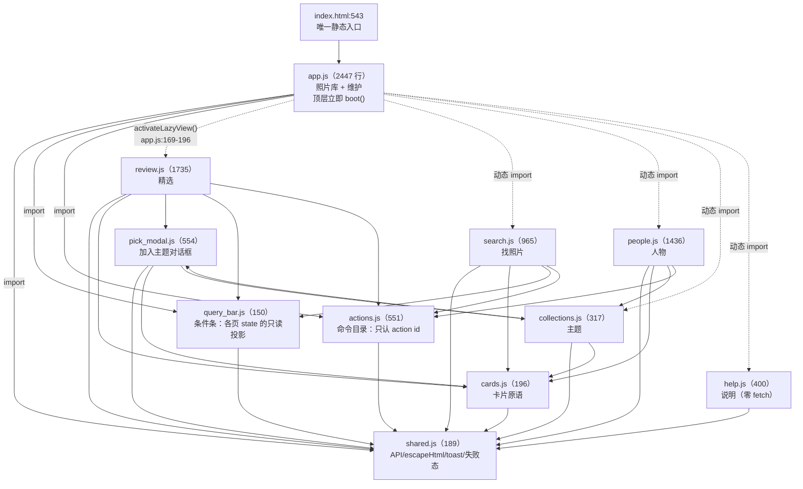

# 60 · 前端架构

> PhotoOS 的前端是**零构建的原生 ES module 单页应用**：没有 npm、没有打包器、没有框架。
> 本篇写清它的模块模型、视图切换、组件契约、设计系统与已知薄弱点。
>
> 【实测】"零构建"可证：全仓**没有 `package.json`**；唯一脚本入口是
> `web/index.html:543` 的一行 `type="module"`。
> 行数一律用 `read`/`grep` 口径（本仓库换行符不统一，PowerShell 的按行读会**少算**，见 Q-1）。

---

## 1. 启动与模块模型

### 1.1 入口与加载顺序

【实测】`index.html`（545 行）只用**一个** `<script>`：

```html
<!-- web/index.html:543 -->
<script type="module" src="/static/js/app.js"></script>
```

7 张样式表按固定顺序加载（`index.html:10-16`），`tokens.css` **必须第一**（`index.html:8-9` 注释声明）。
服务端用通用挂载提供静态资源（`api/app.py:3370` 的 `_NoCacheStatic`），没有单独的字体路由。

### 1.2 模块依赖图



> 【实测】依赖方向有两条**硬约束**，改代码时别违反：
>
> 1. **`app.js` 不能被静态 import** —— 它在模块顶层立即 `boot()`（`app.js:2444-2447`）。
>    需要它时一律函数内动态 `import('./app.js')`，全仓共 **5 处**
>    （`cards.js:149`、`collections.js:131`、`search.js:247`、`people.js:1167`、`people.js:1357`）。
> 2. **`shared.js` 是唯一无副作用的共享层**，其余模块都可以依赖它，它不依赖任何人。
>
> 【实测】视图模块**按需加载**：`app.js:169-196` 的 `activateLazyView()` 是一串
> `if/else + await import()`；而 `deactivateLazyView()`（`app.js:198-203`）
> **只处理 review**（要卸键盘监听）—— 其它视图没有"离开时"的清理。
> 【推断】这是有意的简化：只有工作台绑了 document 级键盘。

### 1.3 没有路由（以及它的后果）

【实测】grep `location.` / `hash` / `pushState` / `popstate` 于 `js/` **没有一处是路由 API**。
切换视图 = 纯内存 + class 切换（`app.js:220-250`）：给 `.tab` 切 `is-active`、
给对应 `section#view-xxx` 切 `is-active`（CSS：`app.css:142-143`）。

**后果（用户能感觉到的）**：

| 后果 | 说明 |
| --- | --- |
| **没有深链接** | 【推断】刷新页面会回到 `library`（`app.js:2420` 硬编码 `setView('library')`） |
| 唯一 URL 锚点是说明页目录 | `help.js` 的 `renderToc()` 产出 `href="#help-…"`，依赖浏览器原生跳转 |
| 跨视图跳转靠函数 | `app.js:211-218` `openWorkbench(sceneId)`（找照片页的"去精选这一场"用它） |

### 1.4 状态：每个模块一个私有 `state`，没有 store

【实测】**没有 store、没有事件总线** —— grep `CustomEvent|dispatchEvent` 于 `js/` **零命中**。
每个模块一个模块级 `const state = {...}`（`app.js:75-130`、`review.js:41-95`、
`search.js:56-86`、`people.js:60-75`、`collections.js:19-23`、`pick_modal.js:43-63`）。

【实测】真实存在的跨模块通道只有四类，改代码时要知道它们：

| 通道 | 位置 | 用途 |
| --- | --- | --- |
| `window.photoosRefreshJobs` | 定义 `app.js:2186`；消费 `actions.js:302,518` | 跑完命令后刷新任务表 |
| `window.__reviewBoot` | `review.js:1707,1720-1721` | **仅调试**（`localStorage.photoosDebug === '1'`） |
| 宿主元素上的钩子 | `shared.js:105` `__retryHandlers`、`query_bar.js:138` `__qbRemovers` | 避免闭包陈旧 |
| `dataset` 幂等标记 | `shared.js:106-107` `retryBound`、`cards.js:135-136` `openBound`、`query_bar.js:119-120` `qbBound` | 防重复绑事件 |

⚠️ 【实测】**局部重复实现仍然存在**（已知技术债）：`app.js:26-51` 自带一份 `API`、
`app.js:146-153` 自带一份 `humanBytes`（`shared.js:128-135` 已有一份）。
两份 `handle` **已经漂移**：`shared.js:44` 有 `error.status = response.status`，`app.js` 那份没有；
当前不炸只是因为依赖它的 `people.js:711` 走的是 `shared.js` 的 API。
【推断】这是"零构建 + 无类型系统"下最容易长出来的一类债 —— 没有编译器告诉你两份实现已经不同。

### 1.5 启动序列与轮询

【实测】`boot()`（`app.js:2412-2442`）顺序：
`bindEvents → grid.init → setView('library') → refreshHealth → loadLibraries →
loadBrowseNodes → loadAssets → loadFacets → refreshJobs → refreshAbout`。

* 顺序有理由：`app.js:2423` 注释"**先建浏览树再拉列表**：列表的作用域来自浏览轴，
  顺序反了会先拉一次全库"。
* ⚠️ 【实测】一个已修的启动坑（`app.js:2415-2419`）：`boot()` 里原来**没有** `setView`，
  后果是"筛选台会一直是 `hidden`，而 `hidden` 元素里的 select 点了没有任何反应"。
* 【实测】轮询三档：主轮询 4000 ms（`app.js:2430-2441`）；
  导出任务 1200 ms、上限 1 小时（`app.js:1628-1631`）；
  命令类任务自适应 800 ms 起、×1.3、上限 4000 ms（`actions.js:63-81`）。

---

## 2. 七个视图

【实测】视图容器与"页头统一"由测试钉住（`tests/unit/test_design_system.py:37,147-159`）。

| 视图 | 容器 id | 驱动文件 | 关键交互 |
| --- | --- | --- | --- |
| 照片库 | `#view-library`（`index.html:179`） | `app.js` | 顶栏筛选台、左栏四轴、**自建虚拟网格**、条件条逐个撤 |
| 精选 | `#view-review`（`:237`） | `review.js` | 四层漏斗（地点/日期/关键词/场景）、自绘双月日历、1/2/3/0 打标、比较视图、调整分组 |
| 找照片 | `#view-search`（`:282`） | `search.js` | 两种模式（语义 / 结构化）、卡片"我要这种/不是这种"、Shift 连选 + 吸底多选条 |
| 人物 | `#view-people`（`:352`） | `people.js` | "是他/不是他"单击即重学、模型区与用户区分离、批量四动作、一键确认 |
| 主题 | `#view-collections`（`:374`） | `collections.js` | 成员缩略图网格、上下移/设封面/移出、**共用"添加照片"弹窗**、打包原片 |
| 维护 | `#view-maintenance`（`:398`） | `app.js` + `actions.js` | "预演 → 确认执行"、任务暂停/恢复/取消、命令直跑面板 |
| 说明 | `#view-help`（`:507`） | `help.js` | 四步上手 + 10 个任务入口 + 14 节功能详解 + FAQ / 术语表；目录吸顶，**零请求** |

> 说明页在 2026-10-21 重写过：旧版“右侧抽屉 / 下载原片 / 本机信息”三处与实现不符的
> 文案已按实现改正（原 Q-23）。人物页「重新学习全部」是否已接线仍需单独核对（原 Q-22）。

---

## 3. 组件契约

### 3.1 照片库网格：**自己实现的虚拟列表**

【实测】`app.js:253-461` 的 IIFE `grid` 是独立实现（**没有**用 `cards.js`）：

| 机制 | 位置 | 要点 |
| --- | --- | --- |
| DOM 池复用 | `app.js:257,284-294` | 池里节点反复用，`paint()` 只改会变的字（`:338-369`） |
| 只渲染可视区 | `app.js:379-380` | 上下各 **2 行**缓冲；容器高度由总行数撑开（`:376`） |
| 滚动只监听一次 | `app.js:403-404,427` | 注释说明避免双监听双渲染 |
| 触底回调"重新武装" | `app.js:408-421` | 防抖 |
| 同组多文件**只做视觉分组、不折叠** | `app.js:317-328,360-367` | 角标形如 `NEF · 1/2`；实测"2 个文件的组有 4,462 个" |

⚠️ 【实测】**两处注释与实现不符**：`app.js:273` 声称"竖构图占 1 格，横构图占 2 格"，
但 `itemHeight()` 忽略入参、恒返回 `rowHeight`（`:272-275`）；`app.js:8` 声称
"用 preview 表记录的宽高预留占位框"，代码里**没有读 preview 宽高**。

### 3.2 `cards.js`：卡片原语（只覆盖非虚拟页面）

* 【实测】图源模板收敛在这里（`cards.js:32-41` 的 `assetImageUrl()`），
  默认 `loading="lazy"`，首屏显式传 `eager`（`:52-57`）。
* 【实测】点击协议：事件委托 + 白名单选择器 `OPEN_SELECTORS`（`:125,134-152`），
  带 `data-act` 的元素跳过 —— 否则人物页会开两次弹窗（`:142` 注释）。
* 【实测】徽标**故意拆成 `build`/`update` 两个函数**（`:162-175`），理由写在 `:159-160`：
  **返回 HTML 串会毁掉虚拟网格的 DOM 复用**。
* 【实测】时刻拆成日/时两段（`:183-196`），避免出现"2026-05-31 23:44 23:44"。

### 3.3 分页与"加载更多"

* 【实测】每页默认 **300**，可选 100/300/1000（`app.js:82`、`index.html:163-167`）。
* 【实测】"继续加载"是**追加**而非翻页（`app.js:572-574` → `loadAssets({append:true})`）；
  追加时不重置滚动（只在 `!append` 时 `scrollToTop()`）。
* 【实测】无限滚动与按钮**共用同一入口**（`app.js:2122-2124`）。

### 3.4 `pick_modal.js`：三层来源的"加入主题"

* 【实测】三个来源（`pick_modal.js:37-41`）：`selection`（我的精选）/
  `folder`（物理目录 → `GET /api/scenes/{id}`）/ `collection`（已有主题）。
* 【实测】Tab 切换会清空已选并懒加载 Scene 清单（`:305-313`，用 `?limit=5000`）。
* 【实测】**两个入口共用同一实例**：主题页（`collections.js:122`）与
  工作台"预勾选当前这张"（`review.js:848-864`）。
* 【实测】瑕疵：`pick_modal.js:512-513` 连续两次赋值 `state.source`（第一行是死代码）。

### 3.5 进度、失败态与 toast 的统一约定

* 【实测】toast **全应用只有一份实现**（`shared.js:118-126`；普通 3200 ms、错误 6000 ms）。
* 【实测】失败态是**持久块**而非 toast：`errorHtml()`（`shared.js:81-91`）+
  `bindRetryButtons()`（`:103-116`）。照片库 `#grid-error` 的存在有注释解释
  （`app.js:228-231`：换掉"几秒就消失的 toast"）。
  ⚠️ 【实测】目前**只有两处**用持久失败态（照片库、找照片），
  `review`/`people`/`collections` 的 catch 仍是 toast —— 与 `docs/11` 记的"未达成"一致。
* 【实测】命令类进度能认出 `123/456` 或 `(40.0%)` 就画确定进度，
  否则画"已输出 N 行"的流动条（`actions.js:307-325,349-411`），
  且**一旦认出确定值就不再回退**（`:390-398`）。

---

## 4. 设计系统

### 4.1 令牌：99 个定义，全部在 `tokens.css`

【实测】按行首统计：全 web 目录 **99 处** `--name:` 定义，**99 处全在 `tokens.css`**（314 行）。
分组：`@font-face`（`:45-83`）、中性色（`:86-106`）、皇家蓝（`:108-124`）、
复古金（`:126-141`）、酒红（`:143-154`）、功能色（`:156-167`）、字体栈（`:169-180`）、
字号（`:182-193`）、圆角（`:195-201`）、间距（`:203-228`）、阴影/焦点/控件（`:230-263`）、
动效（`:265-270`）、布局固定尺寸（`:272-274`）、尾部"没人用的令牌"说明（`:287-313`）。

样例值：`--ink-base:#0a0e1a`、`--royal-700:#0a2463`、`--gold-500:#f4d35e`、`--wine-600:#d8315b`、
`--fs-2xs…lg = 10.5/11.5/12.5/13/14/15px`、`--r-sm…pill = 4/8/12/20/999px`、
`--sp-1…7 = 4/6/8/12/16/20/26px`、`--control-h: 42px`、`--wb-label-w: 96px`、
`--measure-prose: 68ch`、`--topbar-h: 56px`、`--sidebar-w: 288px`。

* 【实测】**没有 z-index 令牌**：z-index 全是字面量（散在 6 张表里）—— 这是一个已知的缺口。
* ✅ 【实测】`tokens.css` 的"令牌统计"注释**本轮已按实测重写**：99 个定义 / 86 个有人用 / 13 个零引用（原来写"106 / 27"，已过期）→ Q-24 已修。
* ✅ 【实测】唯一一处 `tokens.css` 之外的令牌**不是违例**：
  `app.css:1156` 在 `@media (max-width: 900px)` 里把 `--sidebar-w` 覆盖成 220px
  （tokens.css `:274` 是 288px）—— **响应式覆盖**，不是"定义在两处"。

### 4.2 三色语义（照抄原文，别自由发挥）

| 色 | 值 | 含义 |
| --- | --- | --- |
| 皇家蓝 | `#0A2463` | 导航与主操作（"进行中/可点的动作"） |
| 复古金 | `#F4D35E` | 高亮与**"你的选择"** —— **不表示"更好"** |
| 酒红 | `#D8315B` | 错误与危险；语义色、不作装饰、**一屏 ≤2 处** |

【实测】硬纪律原文（`tokens.css:40-42`）：不做评分/星级/推荐/匹配度大字的视觉语言。
绿/琥珀只作功能色，不参与品牌表达（`tokens.css:157-163`，`--fail` 复用酒红）。

### 4.3 字体：已修好的历史缺陷，但**没有测试守它**

* 【实测】4 条 `@font-face` 全在 `tokens.css:56-83`，均 `font-display: swap`；
  挂载点唯一（`app.css:32`）。
* 【实测】**当前不存在"声明了但从未加载"**：`@font-face` + `src url()` + 磁盘文件
  （GET `/static/fonts/Inter-latin.woff2` → 200、48,256 B，与 `fonts/provenance.json:38` 一致）
  + 打包清单含字体（`pyproject.toml:95`）齐备。
* ⚠️ 【实测】缺口：`test_design_system.py` 里**没有任何字体断言**，
  也没有测试验证 `src` 路径可达。这条缺陷的守护只在**浏览器脚本**里
  （`venv/check_defect_coverage.py:162-163`，D-64）。
  【推断】也就是说：**要跑浏览器脚本才守得住**，pytest 全绿不代表字体没坏。

### 4.4 控件高度与标签宽：两个"唯一真源"

* 【实测】`--control-h: 42px`（`tokens.css:258`）是**唯一高度真源**；
  文件注释记着旧状："输入框靠 `min-height: 38px`，按钮自然撑出 42px，并排时输入框比按钮矮 4px"。
* 【实测】显式例外（刻意覆盖）：`.btn.small{min-height:34px}`、`.btn.mark{min-height:46px}`
  （注释自陈"注释里曾写 44px 而代码是 46px，**以代码为准**"）、
  `textarea{min-height: calc(var(--control-h) * 1.6)}`。
* 【实测】`--wb-label-w: 96px` 固定标签列宽，理由："两者若各写一个值，
  标签一长一短时控件的起点就会错开"；历史症状有实测数字
  （"相邻时间阈值"宽 92px vs "时段…"宽 430px）。
* 【实测】这些都**有测试钉住**（`test_design_system.py:215-263`）。

### 4.5 深色是**领域性选择**，不是主题功能

【实测】全 web 目录 grep `prefers-color-scheme` **0 命中**、`data-theme` **0 命中**，
JS 里没有主题切换器。

【实测】理由原文（`tokens.css:86-89`）："这是**领域性选择**而非破例：
本应用的全部内容是'看一眼照片然后判断'，浅底会抬高环境亮度、干扰对照片明暗与色彩的判断。"

* 【实测】断点共 14 条 `@media`（720/760/900/1000/1100/1180/1400 等），
  **无 `--bp-*` 令牌、无 `min-width`、无低于 700px 的断点**。
* 【实测】`prefers-reduced-motion` 三处是本项目**唯一**的系统偏好查询。

---

## 5. 键盘（工作台是重点）

【实测】全应用只有两个 document 级 keydown：`app.js:1998-2000`（Esc 关原片弹窗）
与 `review.js:1685`（工作台键表）。工作台的 `KEYS_DOC`（`review.js:97-114`）
与处理器映射（`:1593-1620`）**逐条对得上**：

| 键 | 动作 |
| --- | --- |
| `←`/`A`、`→`/`D` | 上一张 / 下一张 |
| `↑` / `↓` | 跳过本组 / 回本组第一张 |
| `1`/`2`/`3` | 候选 / 精选 / 最终精选 |
| `0` / `Backspace` | 未审阅 |
| `R` | 写理由 |
| `C` | 比较视图 |
| `Space` | 下一张**未审阅** |
| `,` / `.` | 调阈值 |
| `T` / `V` | 加入主题 / 调整分组 |
| `?` | 键位说明 |

* 【实测】输入态一律屏蔽（`review.js:1589-1590`：`input`/`select`/`textarea` 不响应）。
* 【实测】Esc 有优先级：调整面板 > 加入主题弹窗 > 日期弹窗。
* ✅ 【实测】帮助文案与实现一致（`help.js:107-114` 列的键全在映射表内）；
  `S`（"只看未审阅"）已被登记为缺陷 D-57 并守住，当前映射表里**确实没有** `S`。

---

## 6. 文本与说明页

* 【实测】**全部内联中文，没有 i18n 层**：grep `i18n|translate|gettext|locale`
  只命中一处 `localeCompare`；语言只在 `<html lang="zh-CN">` 声明一次。
* 【实测】说明页是唯一的"可版本化文本"：`help.js` 顶部 `HELP_VERSION = '2026-10-t'`。
* 【实测】长文结构：`HELP_SECTIONS` 14 节（字段 `id/tab/title/what/how/limits/cli`），
  另有 `QUICKSTART`（4 步）、`TASKS`（10 个入口）、`FAQ`（6 条）、`GLOSSARY`（9 个术语）；
  `renderHelp()` 一次 `innerHTML` 写入，全部数据过 `escapeHtml`。
* 【实测】`wireToc()` 只读页面滚动位置，给当前目录项加 `aria-current`；不写业务状态。
* 【实测】可读性靠令牌限宽：`--measure-prose: 68ch` 等三个值，
  理由写在 `tokens.css:218-228`（"限宽是为了行长，不是为了对齐"）。

---

## 7. 前端已知薄弱点（诚实清单）

| # | 薄弱点 | 证据 | 影响 |
| --- | --- | --- | --- |
| 1 | **字体没有 pytest 断言**，只有浏览器脚本守 | `test_design_system.py` 无字体断言 | pytest 全绿 ≠ 字体没坏 |
| 2 | 死亡按钮：`#people-learn-all` 在 `js/` 零引用，说明页却教用户点它 | `index.html:358`、`help.js:224` | 用户点了没反应（Q-22） |
| 3 | 说明页三处与实现不符 | `help.js:61,67,70,141,222,308,314,331` | 误导用户（Q-23） |
| 4 | `app.js` 重复实现 `API`/`humanBytes`，且两份 `handle` 已漂移 | `app.js:26-51,146-153` vs `shared.js:11-48,128-135` | 改动只改一处会静默不一致 |
| 5 | 两处注释与实现不符（`itemHeight` 恒等行高；未读 preview 宽高） | `app.js:8,272-275` | 误导后续维护者 |
| 6 | 无路由 → 无深链接，刷新回照片库 | `app.js:2420` | 用户无法分享/书签某个视图 |
| 7 | 只有 2/7 视图用持久失败态，其余仍 toast | `shared.js:81-116` 的使用面 | 失败信息会自己消失 |
| 8 | 测试里有空洞断言 | `test_design_system.py:278`（断言 JS 导出语句不在 CSS 里，永不可能失败） | 给人"有守护"的错觉 |
| 9 | 无 z-index 令牌，字面量散在 6 张表 | 见 §4.1 | 层叠顺序靠人工比对 |
| 10 | `pick_modal.js:512-513` 死代码 | 同上 | 轻微 |

> 【推断】这份清单的共同点：**都不影响主流程，但都会在"下一个人改这里"时收税**。
> 其中 #1、#2、#3 是**用户可见**的，建议优先。

---

## 8. 为什么这些约束值得写进文档

前端有一条别处没有的风险：**它的"正确性"很大程度上不由 pytest 保证**。
【实测】`pyproject.toml:99` 的 `testpaths = ["tests"]` 意味着 pytest 碰不到渲染结果；
设计系统的渲染判据在 `venv/shot_ui.py design`（`getComputedStyle`）里。
【推断】所以本项目的纪律是"**几何与渲染类结论必须看浏览器**"，
对应 `HANDOVER.md` 记的那条教训：几何测量必须先确认视口是真的（曾有探针
在 500×320 的窗口里量了所有布局）。

---

返回 [`00-文档规范与索引.md`](00-文档规范与索引.md) · 相关：[`10-系统全景与架构总览.md`](10-系统全景与架构总览.md)（视图与硬规则）
